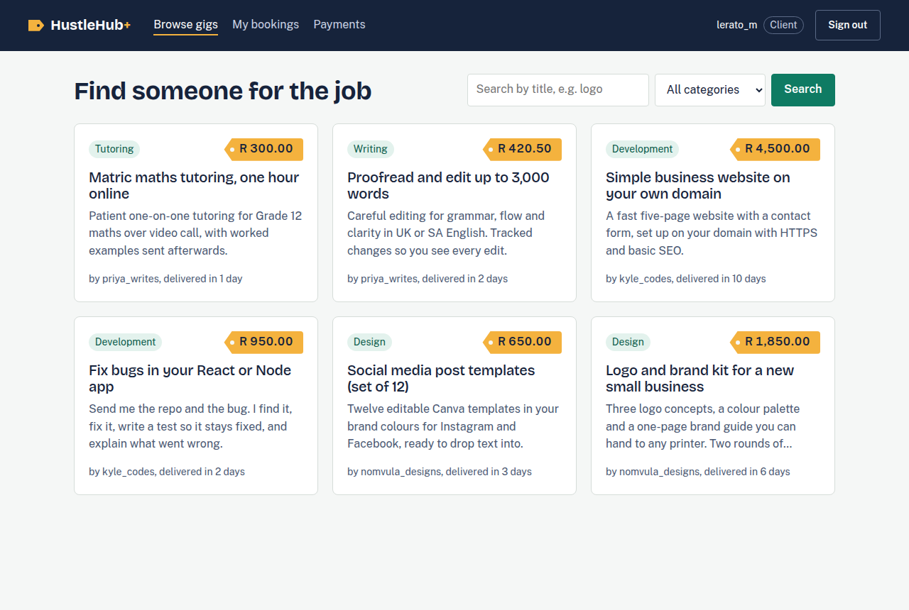
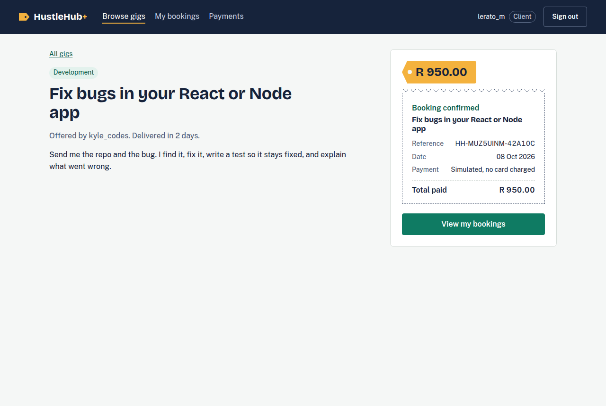
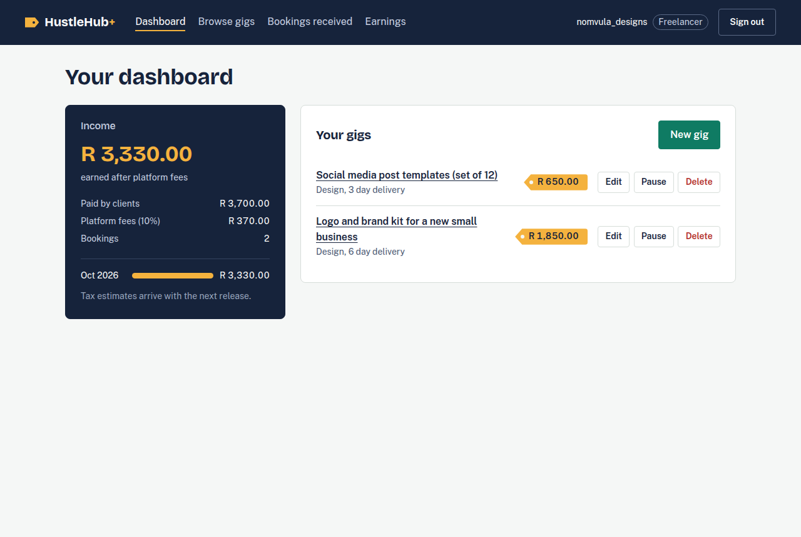
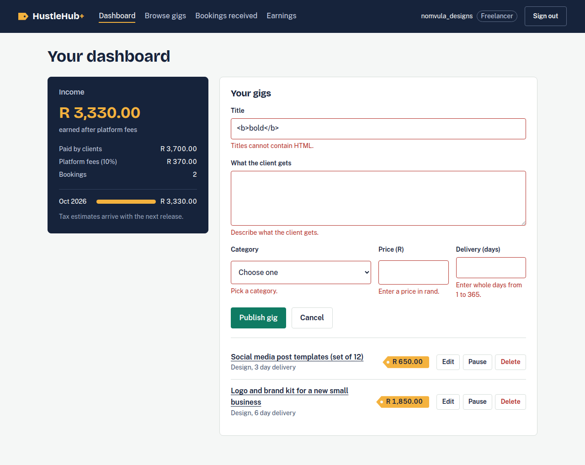
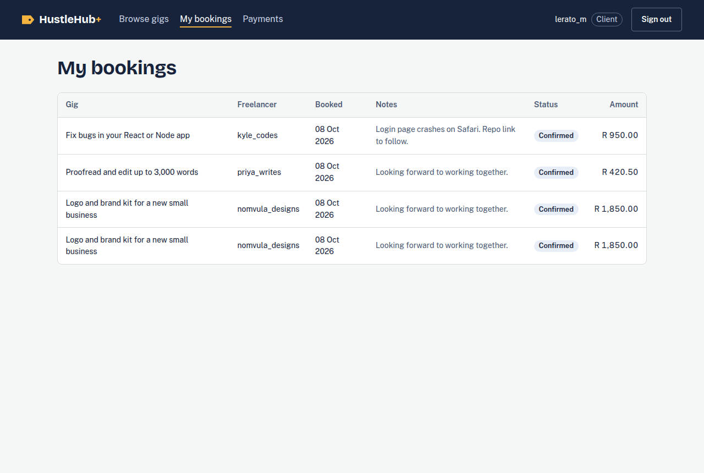
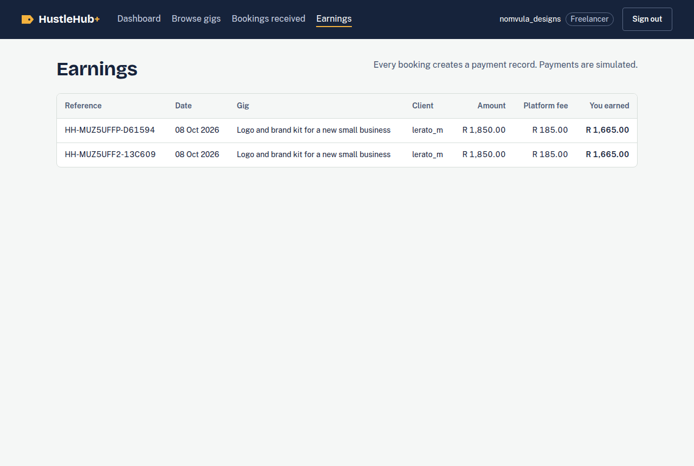
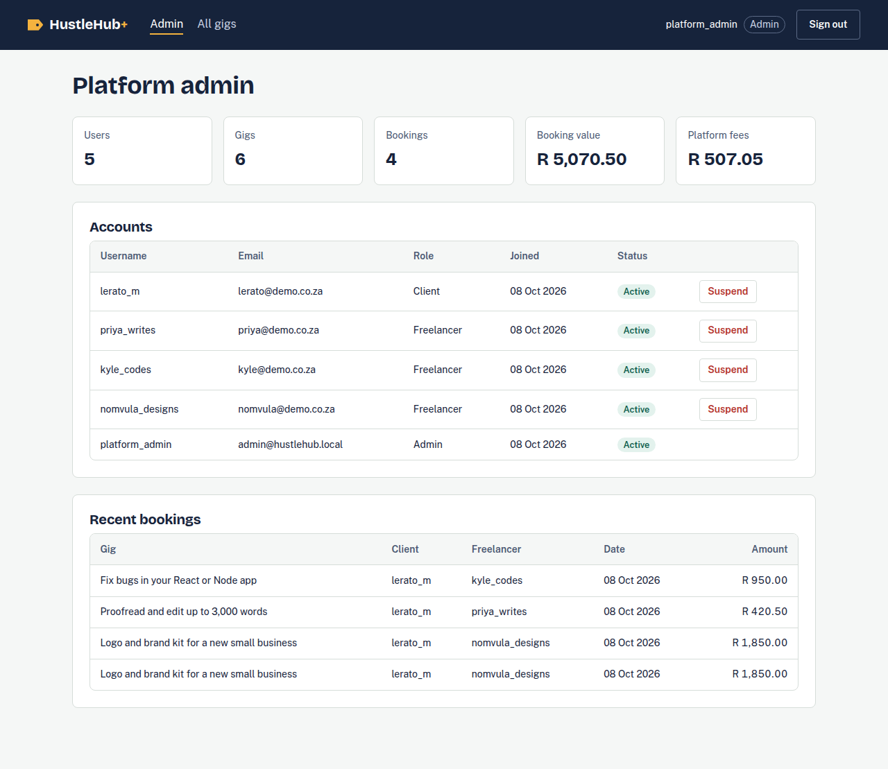
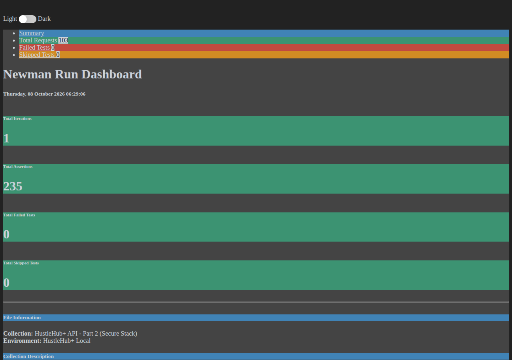
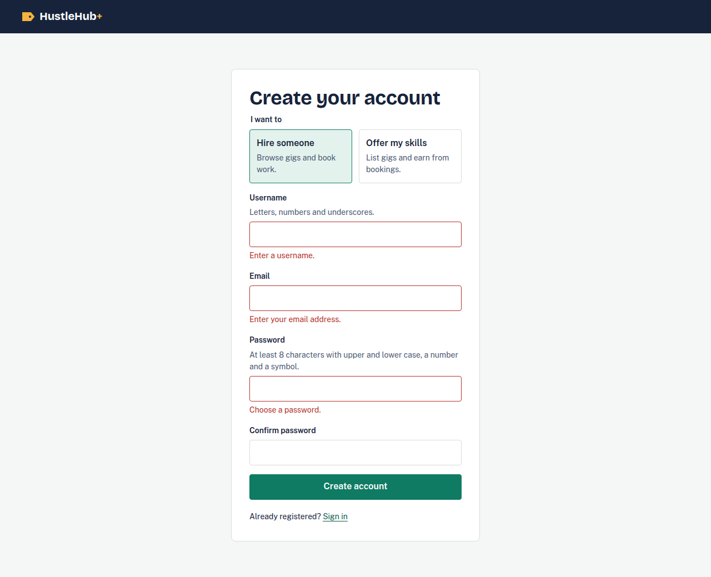
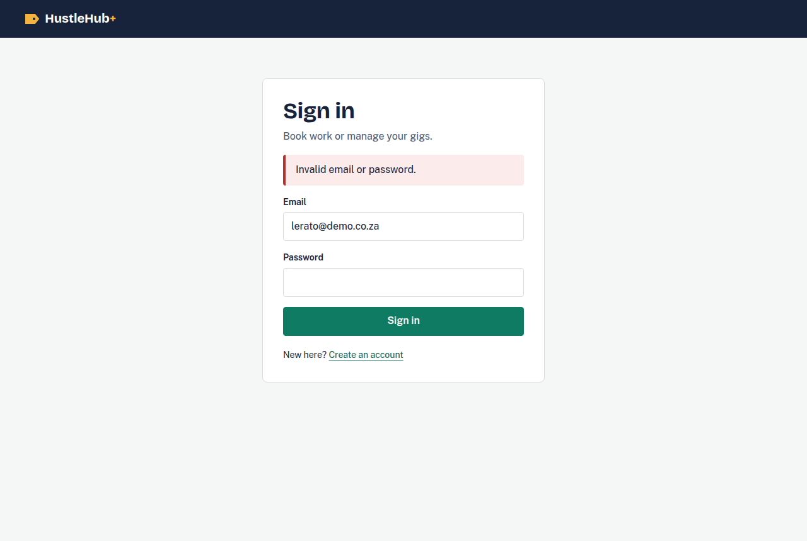

# HustleHub+ | Secure Freelance Marketplace (Part 2: Secure Stack)


> **Module:** INSY7314, Information Systems 3D / APDS7311, Application Development Security
> **POE Part 2:** Secure Stack (full-stack MERN application)

---

## Table of Contents

1. [Overview](#1-overview)
2. [What Changed in Part 2](#2-what-changed-in-part-2)
3. [Part 1 Feedback and How It Was Addressed](#3-part-1-feedback-and-how-it-was-addressed)
4. [Features](#4-features)
5. [Architecture](#5-architecture)
6. [Project Structure](#6-project-structure)
7. [Getting Started](#7-getting-started)
8. [Roles and Permissions (RBAC)](#8-roles-and-permissions-rbac)
9. [API Reference](#9-api-reference)
10. [Data Model](#10-data-model)
11. [Security Implementation](#11-security-implementation)
12. [Testing](#12-testing)
13. [Screenshots](#13-screenshots)
14. [Design Decisions and Trade-offs](#14-design-decisions-and-trade-offs)
15. [Demonstration Video](#15-demonstration-video)
16. [References](#16-references)
17. [Team](#17-team)

---

## 1. Overview

**HustleHub+** is a secure freelance marketplace. **Freelancers** advertise services ("gigs"),
**clients** browse and book them, and every booking produces a **transaction record** so that
freelancers can track the income they have earned. Payments are simulated: no real money moves,
but each booking is recorded exactly as a real payment would be.

The platform handles credentials, transaction records and income data, so security is designed
in at every layer rather than added at the end. Part 1 built the hardened authentication API.
Part 2 extends it into a full MERN stack:

| Layer | Technology | Purpose |
|---|---|---|
| **M**ongoDB | MongoDB + Mongoose 8 | Persistent storage for users, gigs, bookings and transactions |
| **E**xpress | Express 4 on Node.js (HTTPS) | REST API, security middleware, RBAC |
| **R**eact | React 18 + Vite + React Router | User interface for all three roles |
| **N**ode | Node.js 18+ | Runtime for the API and tooling |

## 2. What Changed in Part 2

| Area | Part 1 | Part 2 |
|---|---|---|
| Storage | JSON file (`users.json`) | **MongoDB** via Mongoose models (`User`, `Gig`, `Booking`, `Transaction`) |
| Features | Register, login, profile | **Gig CRUD, browsing/search, booking, transaction recording, income summary, admin panel** |
| Roles | Stored in token only | **RBAC enforced on every route** with `authorize()` plus per-record **ownership checks** |
| JWT | Signature + expiry checked | **Algorithm, issuer and audience pinned**; no fallback secret (Part 1 feedback) |
| Validation | express-validator rules | Rules plus a **strict field allow-list** that rejects unexpected fields (Part 1 feedback) |
| Sanitisation | Trim/escape | **HTML stripping (`xss`)**, **NoSQL operator stripping** (`express-mongo-sanitize`), Mongoose `sanitizeFilter`, **HPP** |
| Rate limiting | None | **Login/register (per IP+email and per IP), booking (per user) and global limits** with clear 429 responses |
| Headers | Helmet defaults | **Explicit Helmet config with strict CSP** on the API and **a separate CSP for the React app** |
| Frontend | None | **React app** served over HTTPS with client-side validation and role-aware navigation |
| Testing | 13 Postman requests | **103 Newman requests / 235 assertions**, **34 Jest backend unit tests**, **27 Vitest frontend tests** |
| Repo layout | Backend at root | **`api/` and `client/` folders** (ready for one Dockerfile each in Part 3) |

## 3. Part 1 Feedback and How It Was Addressed

Part 1 scored 96/100. The marker raised two points, and both are fixed and covered by automated tests.

### 3.1 "Token verification does not enforce the issuer... remove the fallback so a JWT secret is always required, and verify the expected issuer and algorithm."

| Problem | Fix | Where | Proven by |
|---|---|---|---|
| `env.js` fell back to a hard-coded secret if `JWT_SECRET` was missing, so anyone reading the source could forge tokens | The fallback is **removed**. The API **refuses to start** if `JWT_SECRET` is missing or shorter than 32 characters. This applies in every environment, not only production. | `api/src/config/env.js` | Startup fails with a clear `FATAL CONFIG ERROR` message |
| Tokens were signed with an issuer, but verification did not check it | Signing sets `algorithm: HS256`, `issuer`, `audience` and `subject`. Verification passes `algorithms: ['HS256']`, `issuer` and `audience`, so all three must match. | `api/src/utils/generateToken.js` | `api/tests/token.test.js`: wrong issuer, wrong audience, wrong algorithm (HS512), `alg: none`, wrong secret are all rejected |
| (Related hardening) | The user is re-loaded from the database on every request, so a deleted or **suspended** account loses access immediately, even with an unexpired token | `api/src/middleware/authMiddleware.js` | Newman: *"Suspended user's existing token stops working (401)"* |

### 3.2 "The implementation does not actually reject unexpected request fields even though the README describes an allow-list approach."

| Problem | Fix | Where | Proven by |
|---|---|---|---|
| Extra properties in a request body were silently ignored instead of rejected | New `allowOnlyFields()` middleware runs **before** validation on every route. Any body or query property not on that route's list returns **400** *"Request contains N unexpected field(s)"*. Non-object bodies (e.g. arrays) are also rejected. | `api/src/validators/common.js` | `api/tests/middleware.test.js`, `api/tests/app.test.js`, and Newman requests tagged **[Part 1 fix]** |
| Controllers could read any `req.body` property | After validation, controllers read **only** `req.validated.body` (built with `matchedData()`), so an unvalidated value can never reach the database | `api/src/validators/common.js` and all controllers | Mass-assignment tests: `role: "admin"`, `isAdmin`, `freelancer` (gig owner) and `amount` (booking price) are all rejected |

### 3.3 Other Part 1 issues found and fixed

- `package-lock.json` contained a copy of `package.json`. A real lock file is now generated in each of `api/` and `client/`.
- `npm run generate-certs` called `generate-certs.sh`, but the file was named `generate-cert.sh`. The script was renamed, and it now adds a `subjectAltName` so modern browsers accept the certificate for `localhost`.
- The architecture diagram's Mermaid block was missing its opening fence and did not render. It is replaced in [section 5](#5-architecture).
- The 404 handler echoed the requested URL back to the client (a reflected-input risk). It now returns a fixed message.

## 4. Features

**Clients**
- Register and sign in (role chosen at sign-up: *Hire someone* or *Offer my skills*)
- Browse active gigs with title search, category filter and pagination
- View a gig and book it with optional notes; receive an on-screen **receipt** with the transaction reference
- See their bookings and their payment history

**Freelancers**
- Dashboard with **income summary**: amount paid by clients, 10% platform fee, net earnings, booking count and a month-by-month breakdown
- Create, edit, **pause/resume** and delete their own gigs
- See bookings received and mark them as completed
- See an earnings ledger per transaction

**Admins**
- Platform statistics (users, gigs, bookings, booking value, platform fees)
- View all accounts; **suspend or reactivate** clients and freelancers (suspension takes effect instantly)
- View all bookings and transactions; remove any gig (moderation)
- Admin accounts **cannot** be created through sign-up, only with `npm run seed:admin`

**How a booking becomes income**

1. A client books a gig. The API reads the **price from the database**; the request contains only `gigId` and optional `notes`.
2. A `Booking` is saved with a **snapshot** of the gig title and price, so later edits or deletion of the gig do not change history.
3. A `Transaction` is created with a unique reference (`HH-…`), the amount, a 10% platform fee and the freelancer's earnings. If the transaction cannot be saved, the booking is rolled back so the two never disagree.
4. The freelancer's income summary is calculated from their transaction records, so it always matches the ledger.

Transactions are **read-only**: there is deliberately no endpoint to create, edit or delete one directly.

## 5. Architecture


```

**Trust boundaries**

- **Browser to servers:** everything travels over HTTPS. The React app only ever talks to its own origin (`/api` is proxied), so its CSP can be `connect-src 'self'`.
- **Edge of the API:** headers, size limits, sanitisation and rate limits apply to every request before any route code runs.
- **Authentication boundary:** `protect()` sits in front of every route except `register`, `login` and `health`.
- **Authorisation boundary:** `authorize()` checks the role; controllers then add **ownership** to the database query itself (e.g. `{ _id, freelancer: req.user.id }`), so another user's record is never loaded at all.
- **Data boundary:** password hashes have `select: false` and are stripped by `toJSON`; other users are only ever exposed by `username`.
- **Error boundary:** one global handler is the only way an error becomes a response.

The Part 1 diagram is kept for comparison at `docs/architecture/part1-architecture.png`.

## 6. Project Structure

```
.
├── api/                              # Express + MongoDB backend
│   ├── src/
│   │   ├── app.js                    # Middleware order + route mounting
│   │   ├── server.js                 # HTTPS server + DB connection
│   │   ├── config/
│   │   │   ├── env.js                # All env vars, fail-fast checks (no fallback secret)
│   │   │   └── db.js                 # Mongoose connection, strictQuery + sanitizeFilter
│   │   ├── models/                   # User, Gig, Booking, Transaction schemas
│   │   ├── controllers/              # auth, gig, booking, transaction, income, admin
│   │   ├── routes/                   # One router per resource, RBAC declared per route
│   │   ├── middleware/
│   │   │   ├── authMiddleware.js     # protect() + authorize()
│   │   │   ├── rateLimiters.js       # auth, auth-per-IP, booking, global limiters
│   │   │   ├── securityHeaders.js    # Helmet + CSP + no-store
│   │   │   └── errorMiddleware.js    # 404 + global error handler
│   │   ├── validators/               # allow-list + express-validator rules per resource
│   │   └── utils/                    # AppError, JWT helpers, HTML stripping, ownership
│   ├── scripts/seedAdmin.js          # The only way to create an admin
│   ├── tests/                        # Jest unit/HTTP tests (no DB needed)
│   ├── generate-certs.sh             # Local self-signed certificate (with SAN)
│   └── .env.example
├── client/                           # React frontend
│   ├── src/
│   │   ├── api/client.js             # fetch wrapper: token, safe errors, 401 handling
│   │   ├── context/AuthContext.jsx   # session, auto-logout on expiry
│   │   ├── components/               # Layout, ProtectedRoute, GigCard, GigForm, Receipt...
│   │   ├── pages/                    # Login, Register, Browse, GigDetail, Bookings, ...
│   │   ├── utils/                    # validation, formatting, token expiry
│   │   ├── styles/app.css
│   │   └── test/                     # Vitest + React Testing Library tests
│   ├── vite.config.js                # HTTPS, /api proxy, CSP + security headers
│   └── index.html
├── postman/
│   ├── HustleHub-Part2.postman_collection.json   # 87 requests in 7 folders
│   ├── HustleHub-local.postman_environment.json
│   ├── HustleHub-Part1.postman_collection.json   # kept for history
│   └── build_collection.py                       # generates the Part 2 collection
├── docs/
│   ├── architecture/part1-architecture.png
│   ├── evidence/                     # Newman HTML/XML, test logs (see section 12)
│   └── screenshots/
└── README.md
```

## 7. Getting Started

### 7.1 Prerequisites

- [Node.js](https://nodejs.org/) 18 or later (npm included)
- **MongoDB**: either MongoDB Community Server running locally, or a free MongoDB Atlas cluster
- OpenSSL (built into macOS/Linux; on Windows use Git Bash or WSL)
- [Postman](https://www.postman.com/) (optional, for manual testing)

### 7.2 Backend (API)

```bash
cd api
npm install

# 1. Environment file
cp .env.example .env
#    Open .env and set JWT_SECRET. Generate a strong one with:
node -e "console.log(require('crypto').randomBytes(64).toString('hex'))"
#    Set MONGO_URI if you are not using a local MongoDB on 127.0.0.1:27017.

# 2. Local HTTPS certificate (creates api/certs/key.pem and cert.pem)
npm run generate-certs

# 3. Create the admin account (credentials come from ADMIN_* in .env)
npm run seed:admin

# 4. Start the API
npm run dev        # auto-reload
# or
npm start
```

Expected output:

```
Connected to MongoDB
HustleHub+ API listening securely on https://localhost:5000
Environment: development
```

> The API **will not start** without `JWT_SECRET` (32+ characters), `MONGO_URI` and the certificate files. This is intentional (see [section 3](#3-part-1-feedback-and-how-it-was-addressed)).

### 7.3 Frontend (React)

The frontend reuses the certificate in `api/certs`, so generate it first (step 2 above).

```bash
cd client
npm install

# Development (hot reload)
npm run dev

# Production build with the strict CSP (use this for the demo/marking)
npm run build
npm run preview
```

Open **https://localhost:3000**. The certificate is self-signed, so the browser shows a warning
the first time; choose *Advanced → Proceed to localhost*. Requests to `/api` are forwarded to the
API at `https://localhost:5000`.

### 7.4 Accounts for a quick demo

| Role | How to get one |
|---|---|
| Admin | `npm run seed:admin` (default local login: `admin@hustlehub.local` / `ChangeMe!Admin2026`, set in `.env`) |
| Freelancer | Register and choose **Offer my skills** |
| Client | Register and choose **Hire someone** |

> Change `ADMIN_PASSWORD` in `.env` for any shared or deployed environment.

### 7.5 Environment variables (`api/.env`)

| Variable | Required | Description | Example |
|---|---|---|---|
| `JWT_SECRET` | **Yes** | Signing secret, at least 32 characters | *(random 64-byte hex)* |
| `MONGO_URI` | **Yes** | MongoDB connection string | `mongodb://127.0.0.1:27017/hustlehub` |
| `PORT` | No | API port | `5000` |
| `NODE_ENV` | No | `development`, `production` or `test` | `development` |
| `JWT_EXPIRES_IN` | No | Token lifetime | `1h` |
| `JWT_ISSUER` / `JWT_AUDIENCE` | No | Expected `iss` / `aud` claims | `hustlehub-plus-api` / `hustlehub-plus-client` |
| `BCRYPT_SALT_ROUNDS` | No | bcrypt cost factor | `12` |
| `SSL_KEY_PATH` / `SSL_CERT_PATH` | No | TLS key and certificate | `./certs/key.pem` |
| `CORS_ORIGIN` | No | Allowed browser origin(s), comma separated | `https://localhost:3000` |
| `RATE_LIMIT_*` | No | Rate-limit sizes and windows (see [11.5](#115-rate-limiting)) | `10` / `15` |
| `ADMIN_USERNAME` / `ADMIN_EMAIL` / `ADMIN_PASSWORD` | For seeding | Admin account created by `seed:admin` | |

## 8. Roles and Permissions (RBAC)

✅ allowed · ❌ refused (**403**) · 🔒 only their own records (someone else's returns **404**) · 👁 own plus public

| Action | Client | Freelancer | Admin |
|---|:---:|:---:|:---:|
| Browse active gigs / view a gig | ✅ | ✅ | ✅ |
| View a **paused** gig | ❌ (404) | 🔒 | ✅ |
| List "my gigs" | ❌ | 🔒 | ❌ |
| Create a gig | ❌ | ✅ (owner is always themselves) | ❌ |
| Edit / pause a gig | ❌ | 🔒 | ❌ |
| Delete a gig | ❌ | 🔒 | ✅ (moderation) |
| Book a gig | ✅ | ❌ | ❌ |
| My bookings | 🔒 (made) | 🔒 (received) | ❌ |
| View one booking | 🔒 | 🔒 | ✅ |
| Mark booking completed | ❌ | 🔒 | ❌ |
| My transactions | 🔒 (paid) | 🔒 (earned) | ❌ |
| Income summary | ❌ | 🔒 | ❌ |
| All bookings / all transactions | ❌ | ❌ | ✅ |
| User list, suspend/reactivate, stats | ❌ | ❌ | ✅ |

**Why someone else's record returns 404, not 403:** a 403 would confirm that the id exists. Returning
"not found" means an attacker cannot use the API to map out other users' records by guessing ids
(an IDOR probing technique) [2].

**Where it is enforced:** the role is checked by `authorize()` on the route; the ownership rule is
part of the MongoDB filter in the controller. The React app hides links a role cannot use, but that
is only for convenience. The API is the real boundary, which the Newman suite checks by calling
every protected endpoint with the wrong role and the wrong owner.

## 9. API Reference

Base URL: `https://localhost:5000/api`. Every response uses the same envelope:
`{ "success": true|false, "message": "...", "data": { ... } }`.

| Method | Endpoint | Auth | Roles | Body / query (only these fields are accepted) | Rate limit |
|---|---|---|---|---|---|
| GET | `/health` | No | | | global |
| POST | `/auth/register` | No | | `username, email, password, role?` (`client`/`freelancer`) | auth |
| POST | `/auth/login` | No | | `email, password` | auth |
| GET | `/auth/profile` | JWT | any | | global |
| GET | `/gigs` | JWT | any | `?search, category, minPrice, maxPrice, page, limit (≤50)` | global |
| GET | `/gigs/mine` | JWT | freelancer | | global |
| GET | `/gigs/:id` | JWT | any | | global |
| POST | `/gigs` | JWT | freelancer | `title, description, category, price, deliveryDays, isActive?` | global |
| PATCH | `/gigs/:id` | JWT | freelancer (owner) | any of the gig fields (at least one) | global |
| DELETE | `/gigs/:id` | JWT | freelancer (owner), admin | | global |
| POST | `/bookings` | JWT | client | `gigId, notes?` | **booking** |
| GET | `/bookings/mine` | JWT | client, freelancer | | global |
| GET | `/bookings` | JWT | admin | | global |
| GET | `/bookings/:id` | JWT | participant, admin | | global |
| PATCH | `/bookings/:id/complete` | JWT | freelancer (owner) | | global |
| GET | `/transactions/mine` | JWT | client, freelancer | | global |
| GET | `/transactions` | JWT | admin | | global |
| GET | `/income/summary` | JWT | freelancer | | global |
| GET | `/admin/users` | JWT | admin | | global |
| PATCH | `/admin/users/:id/status` | JWT | admin | `isActive` (boolean) | global |
| GET | `/admin/stats` | JWT | admin | | global |

<details>
<summary><strong>Example: POST /bookings</strong></summary>

**Request** (`Authorization: Bearer <client token>`)
```json
{ "gigId": "6ac735549e27884281dd7d45", "notes": "Please use blue and gold." }
```

**201 Created**
```json
{
  "success": true,
  "message": "Booking confirmed. Payment simulated successfully.",
  "data": {
    "booking": { "id": "…", "gigTitle": "Logo design for small businesses", "amount": 900, "status": "confirmed", "client": "…", "freelancer": "…" },
    "transaction": { "reference": "HH-MUZ58YF0-335ABD", "amount": 900, "platformFee": 90, "freelancerEarnings": 810, "currency": "ZAR", "paymentMethod": "simulated", "status": "completed" }
  }
}
```

**Errors:** `400` invalid/unexpected fields (e.g. sending `amount`), `401` no/invalid token,
`403` not a client, `404` gig missing or paused, `429` too many bookings.
</details>

<details>
<summary><strong>Example: GET /income/summary</strong></summary>

```json
{
  "success": true,
  "message": "Income summary retrieved successfully.",
  "data": {
    "currency": "ZAR", "transactionCount": 2,
    "grossIncome": 3700, "platformFees": 370, "netIncome": 3330, "averagePerBooking": 1665,
    "byMonth": [ { "month": "2026-10", "netIncome": 3330, "bookings": 2 } ]
  }
}
```
</details>

<details>
<summary><strong>Status codes used</strong></summary>

| Code | Meaning in this API |
|---|---|
| 200 / 201 | Success / created |
| 400 | Validation failed, unexpected field, malformed JSON, bad id format |
| 401 | Not signed in, token invalid/expired/forged, account suspended |
| 403 | Signed in, but this role may not do this |
| 404 | Not found, **or belongs to someone else** |
| 409 | Email or username already registered |
| 413 | Body over 10 kb |
| 429 | Rate limit reached (includes `retryAfterSeconds`) |
| 500 | Unexpected error (generic message only) |
</details>

## 10. Data Model

| Collection | Key fields | Notes |
|---|---|---|
| `users` | `username` (unique), `email` (unique, lower-case), `password` (bcrypt, `select:false`), `role`, `isActive` | `toJSON` removes `password` and `__v` |
| `gigs` | `freelancer` → User, `title`, `description`, `category` (enum), `price` (R1–R1,000,000, max 2 dp), `deliveryDays`, `isActive` | Paused gigs (`isActive:false`) are hidden from browsing |
| `bookings` | `gig`, `client`, `freelancer`, `gigTitle` and `amount` (snapshots), `notes`, `status` (`confirmed`/`completed`) | Snapshot keeps history correct if the gig changes |
| `transactions` | `reference` (unique), `booking` (unique, one per booking), `client`, `freelancer`, `amount`, `platformFee`, `freelancerEarnings`, `currency`, `paymentMethod: simulated` | No update/delete endpoints |

## 11. Security Implementation

Each control below lists the threat it addresses (mapped to the OWASP Top 10 2021 [1]) and where to find it.

### 11.1 Authentication (JWT) — A07 Identification and Authentication Failures

- **Password hashing:** bcrypt with 12 rounds and a per-password salt. Hashes are never returned (`select:false` + `toJSON`).
- **Strong passwords:** 8–128 characters with upper case, lower case, a number and a symbol.
- **Token contents:** `sub` (user id), `role`, `iss`, `aud`, `iat`, `exp`. No email or other personal data, because a JWT payload is readable by anyone holding it [3].
- **Strict verification:** only `HS256` is accepted, and issuer and audience must match. Unsigned (`alg: none`), re-signed, tampered and expired tokens are rejected [3], [4].
- **No default secret:** the API will not boot without a 32+ character `JWT_SECRET`.
- **Live account check:** every request reloads the user. Suspending a user locks them out immediately.
- **No user enumeration:** login returns the identical message for "unknown email" and "wrong password". A dummy bcrypt comparison runs when the email does not exist, so response time does not give it away either.
- **Admins cannot self-register:** `role` only accepts `client` or `freelancer`. Admins come from `seed:admin`.

### 11.2 Authorisation (RBAC and ownership) — A01 Broken Access Control

- `authorize(...roles)` on each route (table in [section 8](#8-roles-and-permissions-rbac)).
- Ownership is enforced **inside the database query**, e.g. `Gig.findOneAndUpdate({ _id, freelancer: req.user.id })`. There is no "load, then check" gap.
- The owner of a new gig, and the client and freelancer on a booking, always come from the token, **never** from the request body.
- The **price of a booking comes from the database**, so a client cannot choose what they pay.
- Other users' records return **404** to prevent IDOR probing.

### 11.3 Input validation and the field allow-list — A03 Injection, A04 Insecure Design, A08 Data Integrity

- **Allow-list first:** `allowOnlyFields()` rejects any unexpected body or query field (Part 1 fix). This blocks mass assignment such as `role`, `isActive`, `freelancer` or `amount`.
- **Type checks before anything else:** each field must be the expected type (a string, not an object), which blocks operator objects like `{ "$gt": "" }`.
- **Range and format rules:** lengths, enums for category and role, price limits with at most 2 decimals, MongoDB id format for every `:id`, page `limit ≤ 50`.
- **Validated data only:** controllers read `req.validated`, never raw `req.body`.
- The React app runs the same rules for instant feedback, but the API re-checks everything.

### 11.4 Sanitisation (XSS and NoSQL injection) — A03 Injection

| Layer | What it does |
|---|---|
| `xss` library (`utils/sanitize.js`) | Strips **all HTML tags** from free text (titles, descriptions, notes, search), and removes `<script>`, `<style>` and `<iframe>` with their contents. `"<script>alert(1)</script>Logo"` is stored as `"Logo"`. |
| `express-mongo-sanitize` | Removes any key starting with `$` or containing `.` from body, query and params |
| Mongoose `sanitizeFilter` | Wraps unexpected `$` operators in filters with `$eq`. Server-built operators (search regex, price range) are explicitly marked `trusted()` |
| Regex escaping | Search text is escaped before use in `$regex`, preventing regex injection and ReDoS |
| `hpp` | Blocks HTTP parameter pollution (`?category=a&category=b`) |
| React | All output is rendered as text (React escapes it). The app never uses `dangerouslySetInnerHTML`. A frontend test proves an `` title renders as harmless text. |

### 11.5 Rate limiting — A07, A04

Implemented with `express-rate-limit` [5]. Every limit answers with **HTTP 429** [6], the standard
JSON envelope, a clear message and `retryAfterSeconds`, plus standard `RateLimit` / `RateLimit-Policy`
headers so clients can see how much quota is left.

| Limiter | Applied to | Default limit | Keyed by | Purpose |
|---|---|---|---|---|
| `authLimiter` | `POST /auth/login`, `POST /auth/register` | 10 per 15 min | IP + email | Stops password guessing against one account |
| `authIpLimiter` | same | 100 per 15 min | IP | Stops spraying many different emails from one address |
| `bookingLimiter` | `POST /bookings` | 10 per 10 min | user id | Stops fake-booking floods and junk transactions |
| `globalLimiter` | all `/api` routes | 300 per 15 min | IP | Blunts scraping and basic denial of service |

Example 429 response:
```json
{ "success": false, "message": "Too many sign-in attempts. Please wait before trying again.", "retryAfterSeconds": 900 }
```

All limits can be tuned with `RATE_LIMIT_*` variables. The API sets `trust proxy` to 1 and the
frontend proxy forwards the browser's IP (`xfwd`), so limits apply to the real client.

### 11.6 Security headers and Content Security Policy — A05 Security Misconfiguration

**API (Helmet [7]).** The API only returns JSON, so its CSP blocks everything:

```
default-src 'none'; base-uri 'none'; form-action 'none'; frame-ancestors 'none';
script-src 'none'; style-src 'none'; img-src 'none'; connect-src 'self'; object-src 'none';
upgrade-insecure-requests
```

It also sends `Strict-Transport-Security` (1 year), `X-Frame-Options: DENY`,
`X-Content-Type-Options: nosniff`, `Referrer-Policy: no-referrer`, the Cross-Origin
Opener/Embedder/Resource policies, a `Permissions-Policy` that denies camera, microphone,
geolocation and payment, and `Cache-Control: no-store` so personal and financial data is never cached.
`X-Powered-By` is removed.

**React app (`client/vite.config.js`):**

```
default-src 'self'; script-src 'self'; style-src 'self'; img-src 'self' data:;
font-src 'self'; connect-src 'self'; object-src 'none'; base-uri 'self';
form-action 'self'; frame-ancestors 'none'; upgrade-insecure-requests
```

- No inline scripts, no third-party scripts and no CDNs. Fonts are bundled with the app (`@fontsource`) instead of loaded from Google, so `font-src` stays `'self'`.
- `connect-src 'self'` means stolen data cannot be sent anywhere except our own API.
- `frame-ancestors 'none'` blocks clickjacking.
- The dev server (`npm run dev`) needs Vite's hot-reload script, so in development only, a nonce and the HMR websocket are added. `npm run preview` (and the Part 3 container) uses the strict policy above. A browser check of the built app showed **no CSP violations** [8].

### 11.7 Transport security — A02 Cryptographic Failures

Both servers run on HTTPS only (TLS 1.2 minimum on the API). The certificate includes
`subjectAltName=localhost,127.0.0.1` so browsers accept it after the one-off self-signed warning.
In production it would be replaced by a CA-issued certificate.

### 11.8 Error handling and safe responses — A05, A09

- One global handler. Known errors (bad JSON, bad id, duplicate key, schema errors) are translated into safe messages. Anything unexpected returns *"Something went wrong. Please try again later."* with details logged server-side only.
- The 404 handler no longer echoes the requested path.
- Request logs (morgan) never include bodies, so passwords and tokens are not written to logs.
- The React client shows API messages for 4xx errors, but always shows a generic message for 5xx (a test checks that a raw `MongoServerError` is never displayed).

### 11.9 Frontend session security

- The JWT is stored in **sessionStorage**: it is cleared when the tab closes and is not shared across tabs. With the strict CSP there is no inline or third-party script on the page to read it. See [section 14](#14-design-decisions-and-trade-offs) for the trade-off against cookies.
- **Automatic logout** when the token expires (a timer based on the `exp` claim), and whenever the API answers 401.
- The login redirect only follows internal paths (blocks open-redirect tricks such as `//evil.com`).
- Gig ids in the URL are checked before any API call.
- Passwords use `type="password"` with the correct `autocomplete` values, and the password field is cleared after a failed login.

## 12. Testing

| Suite | Tool | What it covers | Result | Evidence |
|---|---|---|---|---|
| API end-to-end | Postman + **Newman** | 87 requests (103 executed with the rate-limit loops) in 7 folders: setup, auth edge cases, gig CRUD/ownership, bookings + transactions, income, admin, rate limiting | **235 / 235 assertions pass** | `docs/evidence/newman-report.html`, `newman-results.xml`, `newman-cli-output.txt` |
| Backend unit + HTTP | **Jest** + Supertest | JWT pinning (issuer/audience/algorithm/`none`/wrong secret), RBAC, allow-list, sanitiser, ownership helper, headers/CSP, 401 on protected routes, NoSQL injection, malformed JSON, oversized body | **34 / 34 pass** | `docs/evidence/backend-unit-tests.txt` |
| Frontend | **Vitest** + React Testing Library + user-event | Rendering and interaction: login/register validation and API errors, role choices, gig card XSS safety, gig form validation, booking flow and receipt, 429 handling, route guards, role-based nav, sign-out | **27 / 27 pass** | `docs/evidence/frontend-tests.txt`, `frontend-test-results.xml` |

### 12.1 Running the Newman suite

With the API running (and `npm run seed:admin` done):

```bash
cd api
npm run test:api
```

This runs `postman/HustleHub-Part2.postman_collection.json` with the
`HustleHub-local.postman_environment.json` environment and writes an **HTML report**
(`newman-htmlextra`) and a **JUnit XML** file to `docs/evidence/`.

**How the collection is organised**

| Folder | Highlights |
|---|---|
| 0. Setup | Creates fresh users for each run (unique emails), logs in each role, checks JWT structure (`HS256`, `sub/role/iss/aud/exp`, no email) |
| 1. Authentication: invalid scenarios | Duplicate, missing fields, weak password, self-assigned admin, **unexpected fields**, script in username, NoSQL injection, wrong password vs unknown email (same message), malformed JSON, tampered token, **`alg:none` token** |
| 2. Gigs | Create, HTML stripped, client 403, no token 401, invalid values, 3-decimal price, cannot set owner, browse/search/filter, unknown query param, limit cap, invalid/non-existent id, my gigs, update own, **other freelancer cannot edit/delete (404)**, pause hides gig, delete own |
| 3. Bookings | Booking creates transaction, amount from gig (not request), notes sanitised, freelancer/admin cannot book, **price tampering rejected**, deleted gig 404, per-role booking lists, unrelated freelancer 404, complete booking rules |
| 4. Transactions and income | Per-user ledgers, **income R900 → fee R90 → net R810 checked exactly**, client blocked from income, admin ledger, transactions are read-only |
| 5. Admin | Stats, users (no hashes), non-admins blocked, gig moderation, **suspension kills an existing token**, suspended login refused, reactivation |
| 6. Rate limiting | Repeats a wrong-password login until **429** and checks the message, `retryAfterSeconds` and `RateLimit` headers; repeats bookings until the **booking 429** |

> The collection uses `pm.execution.setNextRequest()` loops for the rate-limit tests. Rate-limit
> counters are held in memory, so **restart the API** if you run the full collection several times
> within 15 minutes. The collection is generated by `postman/build_collection.py`; edit that script
> and re-run it rather than editing the JSON by hand.

**Manual use in Postman:** import the collection and environment, turn off
*Settings → General → SSL certificate verification* (self-signed certificate), then run the
collection in order.

### 12.2 Running the unit tests

```bash
cd api && npm test            # Jest, needs no database
cd client && npm test         # Vitest
cd client && npm run test:report   # verbose output + JUnit XML into docs/evidence
```

Or from the repository root: `npm test` runs both.

## 13. Screenshots

| | |
|---|---|
| **Browse gigs (client)**<br> | **Booking receipt with transaction reference**<br> |
| **Freelancer dashboard with income**<br> | **Validation: HTML rejected in gig form**<br> |
| **Client bookings**<br> | **Freelancer earnings ledger**<br> |
| **Admin panel**<br> | **Newman report**<br> |
| **Register: inline validation**<br> | **Failed login: generic message**<br> |

More in `docs/screenshots/`, including the mobile layout.

## 14. Design Decisions and Trade-offs

| Decision | Why | Trade-off |
|---|---|---|
| Ownership in the DB query, not a later `if` | No window where another user's data is loaded; fewer places to forget a check | Slightly less generic controller code |
| 404 for other users' records | Prevents id enumeration (IDOR probing) | Less precise for a legitimate user who mistypes an id |
| Booking stores a snapshot of title and price | Financial history stays correct after gig edits or deletion | Some data is duplicated |
| Transactions have no write endpoints | The ledger cannot be edited through the API | Corrections would need an admin tool (future work) |
| JWT in `sessionStorage` + strict CSP | Simple Bearer auth that works the same for the browser and Postman/Newman; no cookies means no CSRF exposure | A successful XSS could read the token. That risk is reduced by HTML stripping, React escaping, a no-inline-script CSP and 1-hour expiry. An httpOnly cookie with CSRF tokens is a possible Part 3 improvement. |
| Same-origin `/api` proxy for the frontend | Lets the React CSP use `connect-src 'self'` and avoids CORS in the browser | Needs a proxy in each environment (Vite now, nginx in Part 3) |
| Self-hosted fonts | Keeps `font-src 'self'` and avoids third-party requests | Slightly larger build |
| In-memory rate-limit store | No extra service needed for Part 2 | Counters reset on restart and are not shared across instances; a Redis store would suit production |
| Rate limits keyed by IP + email and by IP | One attacker cannot lock out everyone on a shared network, but cannot spray emails either | Two limiters to configure |
| Freelancer income = amount − 10% fee | Demonstrates fee/earnings separation that Part 3's tax estimate will build on | The fee rate is a constant in code (`PLATFORM_FEE_RATE`) |

## 15. Demonstration Video , YouTube Link:

https://youtu.be/uqReKYvFHD4

The video demonstrates: registration of a freelancer and a client, login with JWT, gig creation,
browsing and searching, booking with the receipt and transaction reference, the freelancer
viewing the booking and their updated income, the payments ledger, the admin panel, RBAC refusals
(e.g. a client calling an admin endpoint in Postman), rate limiting (429), and the Newman,
Jest and Vitest runs.

## 16. References

[1] OWASP Foundation, "OWASP Top 10:2021," 2021. [Online]. Available: https://owasp.org/Top10/

[2] OWASP Foundation, "Insecure Direct Object Reference Prevention Cheat Sheet," OWASP Cheat Sheet Series. [Online]. Available: https://cheatsheetseries.owasp.org/cheatsheets/Insecure_Direct_Object_Reference_Prevention_Cheat_Sheet.html

[3] M. Jones, J. Bradley, and N. Sakimura, "JSON Web Token (JWT)," RFC 7519, IETF, May 2015. [Online]. Available: https://www.rfc-editor.org/rfc/rfc7519

[4] Y. Sheffer, D. Hardt, and M. Jones, "JSON Web Token Best Current Practices," RFC 8725, IETF, Feb. 2020. [Online]. Available: https://www.rfc-editor.org/rfc/rfc8725

[5] express-rate-limit contributors, "express-rate-limit," npm. [Online]. Available: https://www.npmjs.com/package/express-rate-limit

[6] M. Nottingham and R. Fielding, "Additional HTTP Status Codes," RFC 6585, IETF, Apr. 2012. [Online]. Available: https://www.rfc-editor.org/rfc/rfc6585

[7] Helmet contributors, "Helmet," helmetjs.github.io. [Online]. Available: https://helmetjs.github.io/

[8] MDN Web Docs, "Content Security Policy (CSP)," Mozilla. [Online]. Available: https://developer.mozilla.org/en-US/docs/Web/HTTP/CSP

## 17. Team

| Student number | Name |
|---|---|
| ST10084625 | Caleb Keanu Naidoo |
| ST10460086 | Reece Moodley |
| ST10441678 | Taytem Pillay |

*INSY7314 · POE Part 2*
