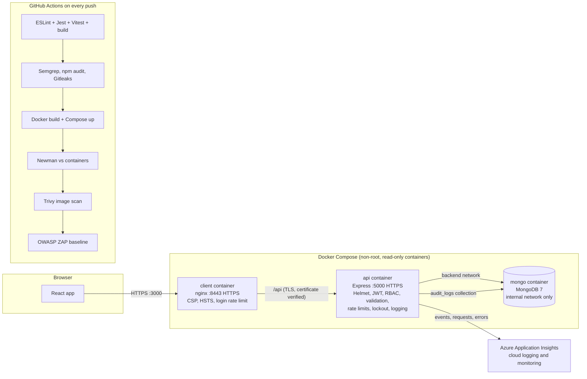
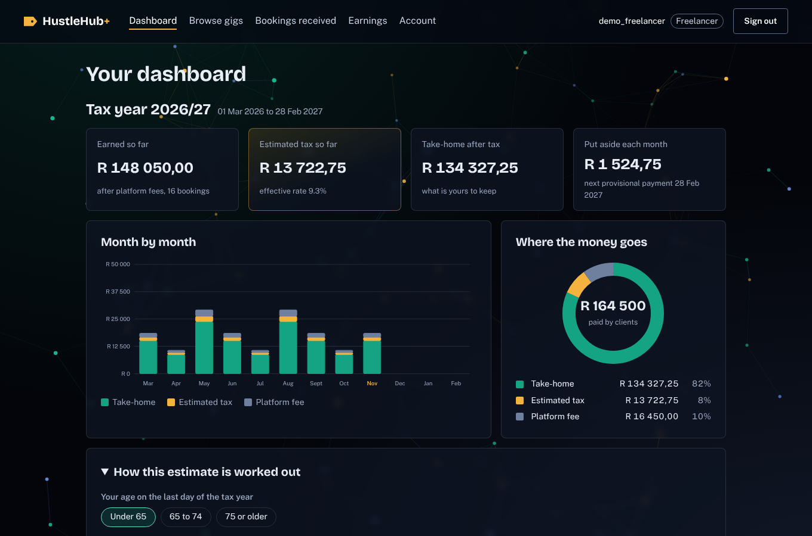
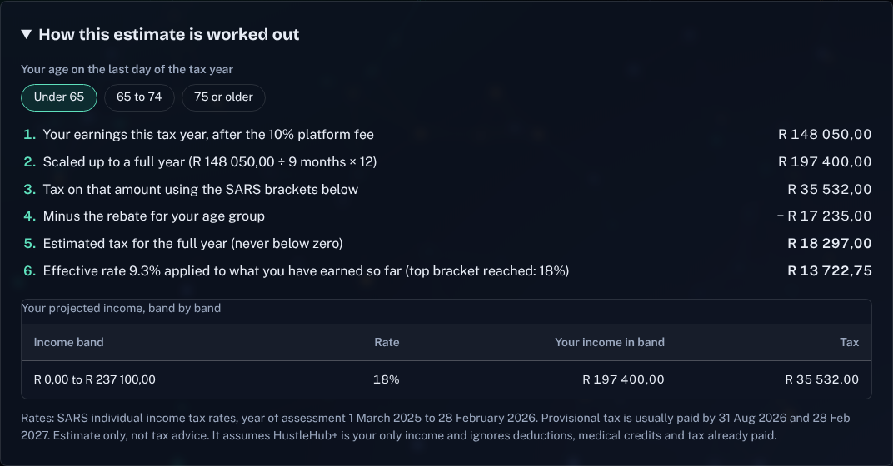
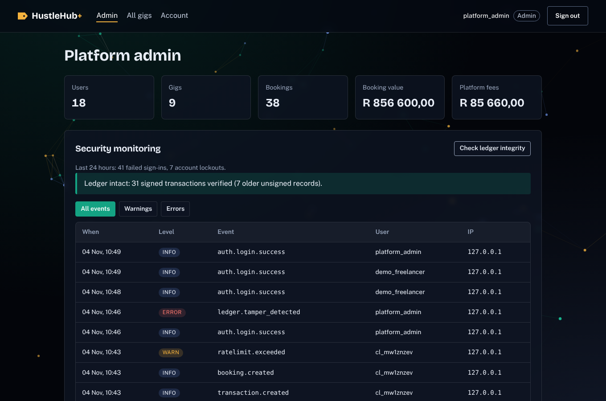
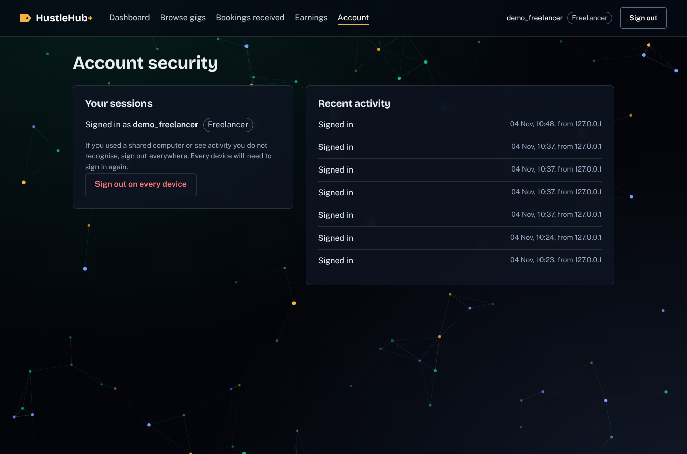
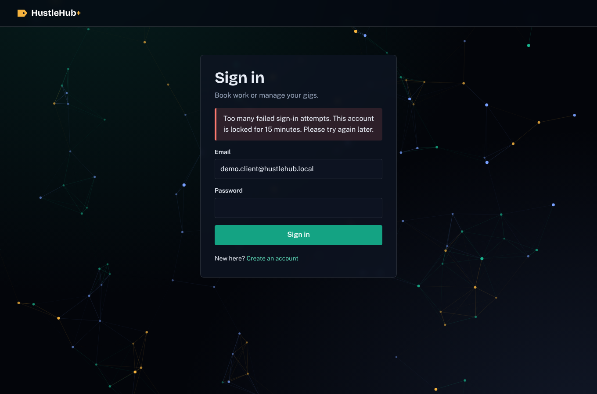
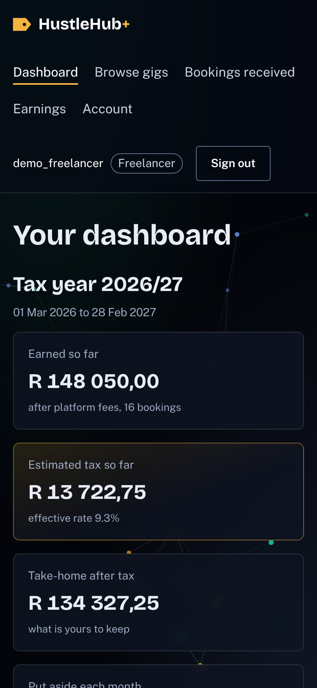

# HustleHub+ | Secure Freelance Marketplace (POE Final: DevSecOps, Monitoring and Finalisation)

[](../../actions/workflows/ci.yml)


> **Module:** INSY7314, Information Systems 3D / APDS7311, Application Development Security
> **Submission:** POE final part (Part 3): DevSecOps, monitoring and finalisation

---

## Table of Contents

1. [Overview](#1-overview)
2. [What Changed in Part 3](#2-what-changed-in-part-3)
3. [Part 2 Feedback and How It Was Addressed](#3-part-2-feedback-and-how-it-was-addressed)
4. [Features (including the tax logic)](#4-features)
5. [Architecture](#5-architecture)
6. [Project Structure](#6-project-structure)
7. [Getting Started](#7-getting-started)
8. [Roles and Permissions (RBAC)](#8-roles-and-permissions-rbac)
9. [API Reference](#9-api-reference)
10. [Data Model](#10-data-model)
11. [Security Implementation](#11-security-implementation)
12. [Additional Security Features (Part 3)](#12-additional-security-features-part-3)
13. [Logging and Monitoring](#13-logging-and-monitoring)
14. [CI/CD Pipeline](#14-cicd-pipeline)
15. [Static Code Analysis](#15-static-code-analysis)
16. [Docker](#16-docker)
17. [Testing](#17-testing)
18. [Final Security Review](#18-final-security-review)
19. [Screenshots and Evidence](#19-screenshots-and-evidence)
20. [Design Decisions and Trade-offs](#20-design-decisions-and-trade-offs)
21. [Demonstration Video](#21-demonstration-video)
22. [References](#22-references)
23. [Team](#23-team)

---

## 1. Overview

**HustleHub+** is a secure freelance marketplace. **Freelancers** advertise services ("gigs"), **clients** browse and book them, and every booking produces a **transaction record**. Payments are simulated: no real money moves, but each booking is recorded exactly as a real payment would be. Freelancers see what they have earned and an **estimate of the income tax** they should set aside.

The platform handles credentials, financial records and income data, so security was designed in at every layer from the start:

| Part | Focus | Result |
|---|---|---|
| Part 1 | Secure backend foundations | Hardened authentication API (bcrypt, JWT, HTTPS, validation, safe errors) |
| Part 2 | Secure full stack | MERN app with RBAC, ownership checks, sanitisation, rate limiting, Helmet and CSP |
| **Part 3** | **DevSecOps, monitoring, finalisation** | **Tax estimation dashboard, CI/CD with security scanning, Docker, structured and cloud logging, four additional security features** |

| Layer | Technology | Purpose |
|---|---|---|
| **M**ongoDB | MongoDB 7 + Mongoose 8 | Users, gigs, bookings, signed transactions, audit log |
| **E**xpress | Express 4 on Node.js 22 (HTTPS) | REST API, security middleware, RBAC, logging |
| **R**eact | React 18 + Vite 8 + React Router 7 | Interface for clients, freelancers and admins |
| **N**ode | Node.js 22 LTS | Runtime for the API and tooling |

---

## 2. What Changed in Part 3

| Area | Part 2 | Part 3 |
|---|---|---|
| Rate-limit retry time | Always reported the full window (feedback) | **Reports the real time left**, in the body and the `Retry-After` header ([section 3](#3-part-2-feedback-and-how-it-was-addressed)) |
| Financial insight | Income summary | **Tax estimate** using the SARS 2026/27 brackets and rebates, annualised for the SA tax year, with charts and a step-by-step explanation ([4.4](#44-tax-estimation-logic)) |
| Tax tables | n/a | **SARS 2026/27 tables** (brackets to R245 100, primary rebate R17 820, threshold R99 000), matching the current tax year of 1 March 2026 to 28 February 2027 ([4.4](#44-tax-estimation-logic)) |
| Dashboard | Income panel and gig list | **Headline figures, monthly stacked bar chart, money-split donut chart, method panel with age-group choice** |
| Logging | `morgan` to the console | **winston** [14] structured JSON logs to console, rotating files and **Azure Application Insights (cloud)**, plus a MongoDB **audit trail**, request ids and automatic redaction ([section 13](#13-logging-and-monitoring)) |
| Extra security | None required | **Account lockout, server-side sign-out, tamper-evident ledger, security audit trail** ([section 12](#12-additional-security-features-part-3)) |
| Static analysis | None | **ESLint security rules + Semgrep (217 rules)**, every finding fixed and explained ([section 15](#15-static-code-analysis)) |
| CI/CD | None | **GitHub Actions**: lint, unit tests, build, Semgrep, npm audit, Gitleaks, Docker build, Newman against containers, Trivy, OWASP ZAP ([section 14](#14-cicd-pipeline)) |
| Containers | None | **Dockerfile in `api/` and `client/`**, Docker Compose with MongoDB, non-root read-only containers ([section 16](#16-docker)) |
| Dependencies | Some known advisories | **0 vulnerabilities in everything that ships** (React Router 7, Vite 8, Vitest 5, patched API packages) |
| Tests | 34 Jest, 27 Vitest, 235 Newman assertions | **86 Jest, 46 Vitest, 372 Newman assertions** |
| `.gitignore` | `certs/*.pem` only matched a root folder | **Keys, `.env` files and logs ignored in every folder** (found by the secrets scan) |

---

## 3. Part 2 Feedback and How It Was Addressed

Part 2 scored 98/100. The only point raised:

> *"Your rate-limit response reports the full limit window as the retry time, even when part of that window has already passed. Return the actual remaining wait time."*

| Problem | Fix | Where | Proven by |
|---|---|---|---|
| The 429 handler computed `retryAfterSeconds` from `options.windowMs`, so a user blocked 12 minutes into a 15-minute window was still told to wait 900 seconds | The handler now reads `req.rateLimit.resetTime`, the exact moment this caller's window resets, and returns the seconds left, rounded **up** (so clients never retry early) and never below 1. The same value is sent in the standard `Retry-After` header [22], so body and header always agree. The full window is only a fallback if a store gives no reset time. | `api/src/middleware/rateLimiters.js` (`secondsUntilReset`) | `api/tests/rateLimit.test.js`: a request blocked 25 s into a 60 s window gets **35**, not 60, in body and header. Newman: *"Rate limit - retry time counts down"* waits 3 s and checks the value dropped by about 3 s |

The fix applies to all four limiters (auth per email, auth per IP, booking, global) and to the new account lockout (HTTP 423), which also returns the real time left.

---

## 4. Features

### 4.1 Clients
- Register and sign in (role chosen at sign-up: *Hire someone* or *Offer my skills*)
- Browse active gigs with search, category filter and pagination
- Book a gig with optional notes and get an on-screen receipt with the transaction reference
- See their bookings and payment history
- **Account page:** recent sign-in activity and "Sign out on every device"

### 4.2 Freelancers
- **Tax and income dashboard (Part 3):** see [4.4](#44-tax-estimation-logic)
- Create, edit, pause/resume and delete their own gigs
- See bookings received and mark them completed
- Earnings ledger per transaction, all-time income with a monthly breakdown

### 4.3 Admins
- Platform statistics, plus **failed sign-ins and lockouts in the last 24 hours**
- Suspend or reactivate accounts (instant, and permanently ends existing sessions)
- All bookings and transactions, gig moderation
- **Security monitoring (Part 3):** filterable audit log and a one-click **ledger integrity check**
- Admins cannot sign up; they are created from environment settings only

### 4.4 Tax estimation logic

South African freelancers pay income tax as individuals on a **tax year (year of assessment) from 1 March to the end of February**, usually through provisional tax payments at the end of August and the end of February [19]. The estimate is calculated on the server (`api/src/utils/taxCalculator.js`) from the freelancer's own **verified** transactions; the browser only displays it.

| Step | What happens | Why |
|---|---|---|
| 1 | **Taxable income so far** = net earnings (after the 10% platform fee) from transactions dated in the current tax year | The platform fee is a business cost, so it is not taxed. Earlier tax years are ignored. |
| 2 | **Annualise:** earnings so far ÷ months of the tax year that have started × 12 | Brackets are yearly. Applying them to a part-year figure would make the rate far too low. SARS uses the same idea for provisional tax estimates. |
| 3 | Apply the **progressive SARS brackets** (18% up to R245 100, then 26%, 31%, 36%, 39%, 41% and 45%) [18] | Each slice of income is taxed at its own band's rate |
| 4 | Subtract the **age rebate**: R17 820 (everyone), plus R9 765 from 65, plus R3 249 from 75. Tax cannot go below zero. | This creates the tax threshold (R99 000 under 65), below which no tax is due |
| 5 | **Effective rate** = annual tax ÷ annual income | The share of income that goes to tax overall |
| 6 | **Estimated tax so far** = taxable income so far × effective rate | The amount to have put aside by now |
| 7 | **Monthly set-aside** = annual tax ÷ 12, and the next provisional due date | Something practical to act on |

**Worked example** (also an automated test): R225 000 earned by the end of November (9 months) → R300 000 a year → R44 118 + 26% × R54 900 = R58 392 → minus R17 820 = **R40 572 a year**, effective rate 13.5% → **R30 429 on earnings so far**, about R3 381 a month.

**The dashboard shows** four headline figures (earned so far, estimated tax, take-home, monthly set-aside), a 12-month **stacked bar chart** (take-home, estimated tax, platform fee), a **donut chart** of where clients' money went, and an open "How this estimate is worked out" panel with each step, the age-group choice and a band-by-band table. The charts are plain SVG drawn by React with no chart library, so they work under the strict CSP, and each has a hidden data table for screen readers.

**Accuracy and limits.** The rates are the SARS **2026/27** individual tables (year of assessment 1 March 2026 to 28 February 2027, published in the February 2026 Budget) [18], kept in one object (`TAX_TABLE`) that is updated when SARS publishes new tables. Brackets, base amounts, rebates and thresholds are checked against SARS's published figures in `api/tests/tax.test.js`, and Newman recalculates the estimate independently and compares every figure. The estimate assumes HustleHub+ is the person's only income and ignores deductions, medical credits and tax already paid; the app says so on screen. **It is an estimate, not tax advice.**

### 4.5 How a booking becomes income
1. A client books a gig. The API reads the **price from the database**; the request carries only `gigId` and optional `notes`.
2. A `Booking` saves a snapshot of the title and price.
3. A `Transaction` is created with a unique `HH-…` reference, the 10% fee and the freelancer's earnings, and is **signed with HMAC-SHA256** (Part 3). If it cannot be saved, the booking is rolled back.
4. Income and tax are calculated from transaction records whose signatures still verify.

Transactions are read-only: there is no endpoint to create, edit or delete one directly.

---

## 5. Architecture

<p align="center">
  
</p>
<p align="center"><em>Figure 1: MERN architecture with security layers and trust boundaries (from Part 2, still accurate for the application code)</em></p>

**Figure 2: Part 3 deployment and DevSecOps view**



### 5.1 Trust boundaries

| Boundary | How it is protected |
|---|---|
| **Browser to servers** | HTTPS only. The React app only talks to its own origin (`/api` is proxied), so its CSP can be `connect-src 'self'`. |
| **Frontend container to API container** | HTTPS with the API certificate **verified** by name (`api`). nginx overwrites `X-Forwarded-For`, so clients cannot fake their IP to dodge rate limits. |
| **API to database** | MongoDB has authentication on, sits on an internal Docker network and is **never published** to the host. |
| **Edge of the API** | Request id, security headers, size limits, sanitisation and rate limits run before any route code. |
| **Authentication** | `protect()` verifies the JWT (algorithm, issuer, audience, expiry), then checks the account is active, the token was not signed out and its version is current. |
| **Authorisation** | `authorize()` checks the role. Ownership is part of the database query itself. |
| **Data at rest** | Password hashes are never returned. Transactions carry an HMAC signature. Audit entries expire after 90 days. |
| **Errors and logs** | One error handler; secrets are redacted before any log is written. |

---

## 6. Project Structure

```
.
├── .github/
│   ├── workflows/ci.yml          # CI/CD pipeline (section 14)
│   └── dependabot.yml            # Weekly dependency update PRs
├── api/                          # Express + MongoDB backend
│   ├── Dockerfile                # Multi-stage, non-root, no npm at runtime
│   ├── .dockerignore
│   ├── eslint.config.js          # ESLint + eslint-plugin-security
│   ├── healthcheck.js            # Docker HEALTHCHECK
│   ├── src/
│   │   ├── app.js / server.js    # Middleware order; HTTPS server, graceful shutdown
│   │   ├── config/               # env.js (fail-fast secrets), db.js
│   │   ├── models/               # User, Gig, Booking, Transaction, AuditLog, LoginAttempt, RevokedToken
│   │   ├── controllers/          # auth, gig, booking, transaction, income (tax), admin (audit, ledger)
│   │   ├── routes/
│   │   ├── middleware/           # auth, rate limits, security headers, request id + access log, errors
│   │   ├── validators/           # allow-list + rules per route
│   │   ├── telemetry.js          # Azure Application Insights start-up
│   │   └── utils/                # logger, azureTransport, audit, lockout, ledger, taxCalculator, JWT, sanitise
│   ├── scripts/                  # seedAdmin, seedDemo, tamperDemo, signLegacyTransactions
│   └── tests/                    # Jest: tax, ledger, lockout, logger, rate limit, JWT, HTTP
├── client/                       # React frontend
│   ├── Dockerfile                # Vite build, then nginx-unprivileged
│   ├── nginx.conf + nginx/       # HTTPS, CSP and headers, verified /api proxy
│   ├── eslint.config.js          # ESLint + security, React, hooks, a11y
│   └── src/
│       ├── components/charts/    # MonthlyChart, MoneySplit (SVG, CSP-safe)
│       ├── components/TaxPanel.jsx
│       ├── pages/                # incl. AccountPage, AdminPage (security monitoring)
│       └── test/                 # Vitest + React Testing Library
├── docker/make-certs.sh          # Shared dev certificate (localhost + api)
├── docker-compose.yml            # mongo + api + client
├── .env.example                  # Docker settings
├── .semgrepignore
├── postman/                      # Part 3 collection (129 requests) + generator; Parts 1 and 2 kept
└── docs/
    ├── evidence/                 # Newman, Jest, Vitest, static analysis, logging, Docker
    └── screenshots/
```

---

## 7. Getting Started

### 7.1 Prerequisites
- **Docker Desktop** (the recommended way to run everything), or
- Node.js 22 LTS, MongoDB 7 (local or Atlas) and OpenSSL to run without Docker
- Postman (optional)

### 7.2 Run everything with Docker (recommended)

```bash
# 1. Settings: copy the example and fill in the secrets
cp .env.example .env
#    Generate JWT_SECRET, LEDGER_HMAC_SECRET and MONGO_ROOT_PASSWORD (each different) with:
node -e "console.log(require('crypto').randomBytes(48).toString('hex'))"
#    and choose an ADMIN_PASSWORD of 12+ characters.

# 2. Build and start MongoDB, the API and the frontend
docker compose up --build
```

Open **https://localhost:3000** and accept the self-signed certificate warning once. The API is also on **https://localhost:5000/api** for Postman. The admin account is created automatically from `ADMIN_EMAIL` / `ADMIN_PASSWORD`.

```bash
docker compose ps                     # all services healthy
docker compose logs -f api            # live JSON logs
docker compose exec api cat logs/app.log
# Demo data for the dashboard (local only):
docker compose exec -e NODE_ENV=development api node scripts/seedDemo.js
docker compose down                   # stop (add -v to delete the database)
```

### 7.3 Run without Docker

```bash
# API
cd api
npm install
cp .env.example .env        # set JWT_SECRET and LEDGER_HMAC_SECRET (different values)
npm run generate-certs      # api/certs/key.pem + cert.pem
npm run seed:admin
npm run dev                 # https://localhost:5000

# Frontend (second terminal)
cd client
npm install
npm run build && npm run preview   # https://localhost:3000 with the strict CSP
```

> Upgrading a Part 2 database? Run `npm run ledger:sign-legacy` once so older transactions get signatures.

### 7.4 Environment variables

| Variable | Required | Purpose |
|---|:---:|---|
| `JWT_SECRET` | **Yes** | Token signing key, 32+ characters |
| `LEDGER_HMAC_SECRET` | **Yes** | Transaction signing key, 32+ characters, must differ from `JWT_SECRET` |
| `MONGO_URI` (or `MONGO_ROOT_*` in Docker) | **Yes** | Database connection |
| `ADMIN_USERNAME` / `ADMIN_EMAIL` / `ADMIN_PASSWORD` | For seeding | The only way an admin is created |
| `LOCKOUT_MAX_ATTEMPTS` / `LOCKOUT_MINUTES` | No | Lockout policy, default 5 attempts / 15 minutes |
| `LOG_LEVEL`, `LOG_DIR`, `LOG_TO_FILE` | No | Logging, see [section 13](#13-logging-and-monitoring) |
| `APPLICATIONINSIGHTS_CONNECTION_STRING` | No (needed for cloud logging) | Turns on Azure Application Insights |
| `AUDIT_RETENTION_DAYS` | No | Audit entry lifetime, default 90 |
| `RATE_LIMIT_*`, `JWT_EXPIRES_IN`, `BCRYPT_SALT_ROUNDS`, `CORS_ORIGIN`, `SSL_*` | No | As in Part 2 |

The API **refuses to start** if a required secret is missing or too short.

### 7.5 Demo accounts

| Role | How |
|---|---|
| Admin | Created from `ADMIN_*` (local default `admin@hustlehub.local`) |
| Freelancer with a year of data | `npm run seed:demo` → `demo.freelancer@hustlehub.local` / `Demo!Pass2026` |
| Client | `npm run seed:demo` → `demo.client@hustlehub.local`, or register with *Hire someone* |

---

## 8. Roles and Permissions (RBAC)

**Key:** ✅ allowed · ❌ refused (**403**) · 🔒 own records only (someone else's returns **404**)

| Action | Client | Freelancer | Admin |
|---|:---:|:---:|:---:|
| Browse active gigs / view a gig | ✅ | ✅ | ✅ |
| Create a gig | ❌ | ✅ | ❌ |
| Edit / pause a gig | ❌ | 🔒 | ❌ |
| Delete a gig | ❌ | 🔒 | ✅ (moderation) |
| Book a gig | ✅ | ❌ | ❌ |
| My bookings / my transactions | 🔒 | 🔒 | ❌ |
| Mark booking completed | ❌ | 🔒 | ❌ |
| Income summary and **tax estimate** | ❌ | 🔒 | ❌ |
| **Account activity, sign out, sign out everywhere** | 🔒 | 🔒 | 🔒 |
| All bookings / all transactions | ❌ | ❌ | ✅ |
| Users, suspend/reactivate, stats | ❌ | ❌ | ✅ |
| **Audit log, ledger integrity check** | ❌ | ❌ | ✅ |

Another user's record returns **404**, not 403, so the API cannot be used to discover which ids exist (IDOR probing) [2]. The React app hides links a role cannot use, but the API is the real boundary.

---

## 9. API Reference

**Base URL:** `https://localhost:5000/api`. Every response uses `{ "success", "message", "data" }`; errors add a `requestId`.

| Method | Endpoint | Roles | Body / query (only these accepted) | Limit |
|---|---|---|---|---|
| GET | `/health` | public | | global |
| POST | `/auth/register` | public | `username, email, password, role?` | auth |
| POST | `/auth/login` | public | `email, password` | auth + **lockout** |
| GET | `/auth/profile` | any | | global |
| POST | `/auth/logout` | any | | global |
| POST | `/auth/logout-all` | any | | global |
| GET | `/auth/activity` | any (own) | | global |
| GET | `/gigs` | any | `?search, category, minPrice, maxPrice, page, limit` | global |
| GET | `/gigs/mine` | freelancer | | global |
| GET | `/gigs/:id` | any | | global |
| POST | `/gigs` | freelancer | `title, description, category, price, deliveryDays, isActive?` | global |
| PATCH / DELETE | `/gigs/:id` | owner (admin may delete) | gig fields | global |
| POST | `/bookings` | client | `gigId, notes?` | **booking** |
| GET | `/bookings/mine`, `/bookings/:id` | participant | | global |
| GET | `/bookings` | admin | | global |
| PATCH | `/bookings/:id/complete` | owning freelancer | | global |
| GET | `/transactions/mine` | client, freelancer | | global |
| GET | `/transactions` | admin | | global |
| GET | `/income/summary` | freelancer | | global |
| GET | `/income/tax-estimate` | freelancer | `?ageGroup=under65 \| 65to74 \| 75plus` | global |
| GET | `/admin/users`, `/admin/stats` | admin | | global |
| PATCH | `/admin/users/:id/status` | admin | `isActive` | global |
| GET | `/admin/audit-logs` | admin | `?level=info\|warn\|error, event=<prefix>, limit≤200` | global |
| GET | `/admin/ledger/verify` | admin | | global |

<details>
<summary><strong>Example: GET /income/tax-estimate</strong> (trimmed)</summary>

```json
{
  "success": true,
  "message": "Tax estimate calculated successfully.",
  "data": {
    "taxYear": { "label": "2026/27", "start": "2026-03-01", "end": "2027-02-28", "monthsElapsed": 9 },
    "taxableIncomeToDate": 148050,
    "projectedAnnualIncome": 197400,
    "taxBeforeRebate": 35532,
    "rebate": 17820,
    "projectedAnnualTax": 17712,
    "effectiveRate": 0.0897,
    "marginalRate": 0.18,
    "estimatedTaxToDate": 13284,
    "takeHomeToDate": 134766,
    "suggestedMonthlySetAside": 1476,
    "taxThreshold": 99000,
    "brackets": [{ "from": 0, "to": 245100, "rate": 0.18, "taxableInBand": 197400, "taxInBand": 35532 }],
    "byMonth": [{ "month": "2026-03", "netIncome": 16650, "estimatedTax": 1493.95, "takeHome": 15156.05 }],
    "provisionalTax": { "firstPeriodDue": "2026-08-31", "secondPeriodDue": "2027-02-28", "nextDue": "2027-02-28" },
    "integrity": { "checked": 16, "valid": 16, "unsigned": 0, "excluded": 0 }
  }
}
```
</details>

<details>
<summary><strong>Status codes</strong></summary>

| Code | Meaning |
|---|---|
| 200 / 201 | Success / created |
| 400 | Validation failed, unexpected field, malformed JSON, bad id |
| 401 | Not signed in; token invalid, expired, signed out or ended; account suspended |
| 403 | Signed in but the role is not allowed |
| 404 | Not found, **or belongs to someone else** |
| 409 | Email or username already registered |
| 413 | Body over 10 kb |
| **423** | **Account temporarily locked after repeated failed sign-ins** (`retryAfterSeconds` + `Retry-After`) |
| 429 | Rate limit reached (`retryAfterSeconds` = real time left, + `Retry-After`) |
| 500 | Unexpected error: generic message and `requestId` only |
</details>

---

## 10. Data Model

| Collection | Key fields | Notes |
|---|---|---|
| `users` | `username`, `email`, `password` (bcrypt, never returned), `role`, `isActive`, **`tokenVersion`** | `tokenVersion` ends all sessions when increased |
| `gigs` | `freelancer`, `title`, `description`, `category`, `price`, `deliveryDays`, `isActive` | Paused gigs hidden from browsing |
| `bookings` | `gig`, `client`, `freelancer`, title and price snapshots, `notes`, `status` | |
| `transactions` | `reference`, `booking` (unique), parties, `amount`, `platformFee`, `freelancerEarnings`, **`signature`** | HMAC-SHA256, never returned by the API |
| **`audit_logs`** | `event`, `level`, `user`, `ip`, `requestId`, `path`, `details`, `expiresAt` | Append-only, TTL 90 days |
| **`login_attempts`** | `key` (SHA-256 of typed email), `failedCount`, `lockedUntil` | Self-deleting (TTL) |
| **`revoked_tokens`** | `jti`, `user`, `expiresAt` | Self-deleting when the token would have expired |

---

## 11. Security Implementation

Each control maps to the OWASP Top 10 2021 [1].

### 11.1 Authentication: A07 Identification and Authentication Failures
- bcrypt (12 rounds) [10], [11]; strong password rules; hashes never returned
- JWT [3] with `sub`, `role`, **`jti`** and **`tv`** (Part 3); only `HS256` accepted, issuer and audience pinned [4], [12]
- No default secrets: the API will not boot without strong `JWT_SECRET` and `LEDGER_HMAC_SECRET`
- Every request reloads the user, so suspended, signed-out or ended sessions are refused at once
- Identical messages and timing for an unknown email and a wrong password [9]
- **Part 3:** account lockout and server-side sign-out ([section 12](#12-additional-security-features-part-3))

### 11.2 Authorisation: A01 Broken Access Control
`authorize(...roles)` on each route; ownership inside the database query; owners and prices always come from the token or the database, never the request; other users' records return 404 [2], [20].

### 11.3 Validation and allow-list: A03, A04, A08
Unexpected fields are rejected (400). Types are checked first, which blocks operator objects. Controllers only read validated data. Part 3 adds the `ageGroup` allow-list and an audit filter that only accepts plain event names (no regular-expression input).

### 11.4 Sanitisation: A03 Injection
`xss` strips HTML, `express-mongo-sanitize` removes `$` and `.` keys (and **Part 3 logs each attempt** as `security.injection_attempt`), Mongoose `sanitizeFilter` neutralises operators, search text is regex-escaped, `hpp` blocks parameter pollution and React escapes all output.

### 11.5 Rate limiting: A04, A07

| Limiter | Applied to | Default | Keyed by |
|---|---|---|---|
| `authLimiter` | login, register | 10 / 15 min | IP + email |
| `authIpLimiter` | login, register | 100 / 15 min | IP |
| `bookingLimiter` | `POST /bookings` | 10 / 10 min | user id |
| `globalLimiter` | all `/api` | 300 / 15 min | IP |
| nginx `limit_req` (Docker) | `/api/auth/login` | 5 / s, burst 10 | IP |

Every 429 returns the **actual remaining wait** in `retryAfterSeconds` and `Retry-After`, plus `RateLimit` / `RateLimit-Policy` headers [5], [6], [22], and is logged as `ratelimit.exceeded`.

### 11.6 Security headers and CSP: A05
The API sends a deny-everything CSP (`default-src 'none'`) through Helmet [7], with HSTS, `X-Frame-Options: DENY`, `nosniff`, `no-referrer`, a restrictive `Permissions-Policy` and `Cache-Control: no-store`. The React app (Vite preview and the nginx container) sends `default-src 'self'` with no inline or third-party scripts, styles or fonts [8]. The Part 3 charts are plain SVG, so the CSP did not need loosening; browser checks showed no CSP violations.

### 11.7 Transport security: A02
HTTPS everywhere (TLS 1.2+), including **between the containers**, where nginx verifies the API's certificate. The development certificate lists `localhost`, `127.0.0.1` and `api`.

### 11.8 Errors: A05, A09
One global handler; unexpected errors return a generic message plus a `requestId`, while details go to the error log.

---

## 12. Additional Security Features (Part 3)

The brief asks for at least two features beyond the minimum. Four were built, each wired into the API, the interface, the logs and the tests.

### 12.1 Account lockout without user enumeration
**Threat:** password guessing spread across many IP addresses (a botnet gets past per-IP rate limits).
**How it works:** after 5 failed sign-ins for the same email within 15 minutes, that email is locked for 15 minutes (HTTP **423**, real `retryAfterSeconds`). While locked, the password is not even checked, so a correct guess during the lock is useless. Attempts are counted by a **SHA-256 hash of the typed email** whether or not an account exists, so a made-up email locks in exactly the same way as a real one and the feature cannot reveal which emails are registered [9]. A successful sign-in clears the counter.
**Where:** `utils/lockout.js`, `models/LoginAttempt.js`, `authController.login`. **Evidence:** `tests/lockout.test.js`, Newman folder 7, screenshot 21.

### 12.2 Server-side sign-out and "sign out on every device"
**Threat:** a stolen or copied JWT keeps working until it expires, even after the user signs out.
**How it works:** every token has a unique id (`jti`). **Sign out** stores that id on a deny-list until the token's own expiry (TTL index), and `protect()` refuses it. **Sign out on every device** increases the user's `tokenVersion`; every older token carries the old version and is refused. **Admin suspension** also increases it, so tokens stay dead even if the account is reactivated (a gap in Part 2) [21].
**Where:** `models/RevokedToken.js`, `authMiddleware.protect`, `/auth/logout`, `/auth/logout-all`, Account page. **Evidence:** Newman folder 7 (*"the same token is now refused"*, *"device B refused too"*, *"Reactivated user's OLD token stays invalid"*), `SecurityFeatures.test.jsx`.

### 12.3 Tamper-evident financial ledger
**Threat:** someone with database access (a leaked connection string, an insider, an injection bug) edits amounts or moves earnings to another freelancer, which would also falsify income and tax figures.
**How it works:** each transaction is signed with **HMAC-SHA256** [16], [17] over its reference, booking, both parties and every amount, using `LEDGER_HMAC_SECRET`, which never touches the database. Verification uses a constant-time comparison. Income and tax **leave out** any record that fails, and the freelancer is told. Admins can run an integrity check that lists tampered references and raises an **error-level** `ledger.tamper_detected` event.
**Demo:** `npm run demo:tamper` edits the newest transaction directly in MongoDB; the admin check then names it. `npm run demo:tamper -- --undo` restores it.
**Where:** `utils/ledger.js`, `models/Transaction.js`, `incomeController`, `adminController.verifyLedger`. **Evidence:** `tests/ledger.test.js`, Newman, screenshot 20.

### 12.4 Security audit trail and user activity
**Threat:** attacks and misuse that nobody notices (OWASP A09 Security Logging and Monitoring Failures [1], [13]).
**How it works:** security and business events are stored in `audit_logs`, which the application **cannot edit or delete** (schema hooks refuse it). Entries expire after 90 days to limit how long IP addresses are kept, in line with POPIA's data-minimisation principle [32]. Admins filter the trail in the app and see 24-hour counts of failed sign-ins and lockouts; **each user sees their own recent activity** and can react to a sign-in they do not recognise. Emails are masked in stored details.
**Where:** `models/AuditLog.js`, `utils/audit.js`, Admin and Account pages.

---

## 13. Logging and Monitoring

### 13.1 What is logged and why

| Event(s) | Level | Why it matters |
|---|---|---|
| `auth.login.success`, `auth.register.success` | info | Who accessed the system and from where; lets users and admins spot unusual sign-ins |
| `auth.login.failed` (reason kept server-side only), `auth.lockout.triggered`, `auth.login.blocked_locked` | warn | Brute-force and credential-stuffing detection |
| `auth.logout`, `auth.logout_all`, `auth.token.rejected` (expired, invalid, signed out, ended) | info / warn | Session lifecycle; replay of stolen tokens |
| `authz.denied` | warn | Repeated 403s show someone probing for access |
| `ratelimit.exceeded` | warn | Automated abuse and DoS attempts |
| `security.injection_attempt` | warn | NoSQL operator injection attempts that were stripped |
| `booking.created`, `transaction.created`, `booking.completed`, `booking.rolled_back` | info / error | Financial audit trail: who paid what, with reference and amounts |
| `gig.created/updated/deleted`, `gig.removed_by_admin` | info / warn | Marketplace changes and moderation |
| `admin.user.status_changed`, `ledger.verified`, **`ledger.tamper_detected`** | warn / error | Privileged actions and data-integrity alerts |
| `error.unhandled` | error | Server faults, with the request id the user sees |
| `http.request` | http | Method, path, status, duration, IP, user and request id for every request |
| `server.started/stopping`, `db.connected` | info | Availability |

**Never logged:** passwords, tokens, `Authorization` headers, cookies, signatures, request bodies or query strings. A redaction step replaces any such field with `[REDACTED]` and masks emails (`c***@example.com`) before any log is written, so even a careless future log call cannot leak them (tested in `tests/logger.test.js`) [13].

### 13.2 Where logs go
1. **Console:** readable in development, JSON in Docker (`docker compose logs api`)
2. **Files:** `logs/app.log` and `logs/error.log`, JSON lines, rotated at 5 MB (Docker volume `api-logs`)
3. **MongoDB `audit_logs`:** the security trail shown in the app
4. **Azure Application Insights (cloud) [15]:** Microsoft's monitoring platform, switched on by `APPLICATIONINSIGHTS_CONNECTION_STRING` (`api/src/telemetry.js`). It receives:
   - every app event from the logger as a **trace**, with its severity (warn → Warning, error → Error) and the event name, request id, user, IP and details as searchable custom dimensions (`api/src/utils/azureTransport.js`, already redacted)
   - errors also as **exceptions**, so they appear on the Failures page
   - every **request** (method, status, duration), every **MongoDB call** and **live metrics** (CPU, memory, request rate), collected automatically by the official SDK

Every line carries the request id, so one id links a user's error message, the access log line and every event in that request.

### 13.3 Monitoring in practice
- Admin page: last-24-hour failed sign-ins and lockouts, warn/error filters, ledger check
- Azure: **Live Metrics** shows requests and failures in real time; **Failures** groups errors; **Logs** answers questions with KQL queries, for example:

```kusto
// Failed sign-ins and lockouts in the last 24 hours
traces
| where timestamp > ago(24h)
| where customDimensions.event in ("auth.login.failed", "auth.lockout.triggered")
| project timestamp, event = tostring(customDimensions.event), ip = tostring(customDimensions.ip), severityLevel
| order by timestamp desc

// Every booking and its transaction
traces
| where customDimensions.event in ("booking.created", "transaction.created")
| project timestamp, event = tostring(customDimensions.event), details = tostring(customDimensions.details)

// Count of each security event this week
traces
| where timestamp > ago(7d) and severityLevel >= 2
| summarize count() by event = tostring(customDimensions.event)
```

- Azure **alert rules** can email the team when `ledger.tamper_detected` or a burst of `auth.lockout.triggered` appears
- Docker health checks mark and restart unhealthy containers

### 13.4 Turning on cloud logging (Azure Application Insights)
1. Sign in at **portal.azure.com** (students can use *Azure for Students* credit).
2. **Create a resource** → search **Application Insights** → **Create**. Choose the subscription, a new resource group such as `hustlehub-rg`, the name `hustlehub-insights`, the region **South Africa North**, and leave the Log Analytics workspace as suggested. **Review + create** → **Create**.
3. Open the new resource. On **Overview**, copy the **Connection String**.
4. Paste it into `.env` (Docker) or `api/.env` as `APPLICATIONINSIGHTS_CONNECTION_STRING=...`, then restart the API. The start-up log shows `"cloudLogging": true`.
5. Use the app (fail a few logins, make a booking), then open **Live Metrics** to see requests immediately. Traces appear under **Logs** after about 2 to 5 minutes; run the queries in 13.3.

The connection string is a secret: it stays in `.env`, which is never committed.

**Evidence:** `docs/evidence/logging/app-log-sample.jsonl`, `docs/evidence/logging/audit-log-export.json`, the pipeline's `docker-stack-evidence` artifact, and the Azure screenshots `docs/screenshots/22-azure-logs.png` (a Logs query showing the security events) and `docs/screenshots/23-azure-live-metrics.png`. The Azure output was also checked end to end before submission: the official SDK delivered the app's traces (with correct severities), requests and MongoDB calls, and no password, email address or token was present in what was sent.

---

## 14. CI/CD Pipeline

`.github/workflows/ci.yml` [26] runs on every push to `main`, `develop` and `feature/**`, on pull requests and on demand. The workflow only has read access to the repository, and Dependabot opens weekly update PRs that go through the same checks.

| Job | Steps | Fails when |
|---|---|---|
| **backend** | `npm ci` → ESLint (security rules) → Jest with coverage | any lint error or failing test |
| **frontend** | `npm ci` → ESLint (security, React, hooks, a11y) → Vitest → production build | lint error, failing test, build error |
| **sast** | Semgrep with OWASP Top 10, JavaScript, Node, Express, React, JWT and secrets rule packs [27] | any warning or error finding |
| **dependencies** | `npm audit --omit=dev` for API and client; full reports uploaded | any high or critical advisory in shipped packages |
| **secrets** | Gitleaks [31] on the current files (blocking) and full history (report) | a secret is committed |
| **docker-stack** (after backend and frontend) | throwaway secrets → `docker compose build` → `up` → wait for health → header, CSP and proxy smoke test → **Newman (372 assertions) against the containers** → **Trivy** scan of both images [29] → **OWASP ZAP baseline** [30] → logs collected → `down` | unhealthy containers, any Newman failure, any fixable high/critical image vulnerability |

The ZAP baseline is report-only because it scores informational alerts that do not apply to a JSON API behind a strict CSP; its HTML report is uploaded for review. Every job uploads its reports as artifacts, so each run is its own evidence.

**Evidence:** the Actions tab (screenshot `docs/screenshots/24-github-actions.png`) and `docs/evidence/pipeline/local-pipeline-checks.txt` (actionlint, Gitleaks and npm audit run locally).

---

## 15. Static Code Analysis

Two tools: **ESLint** with `eslint-plugin-security` [28] (plus React, hooks and accessibility rules on the client), run in the backend and frontend jobs, and **Semgrep** [27], run in the `sast` job. Reports are in `docs/evidence/static-analysis/`, and the "before" reports are kept to show what was fixed.

### 15.1 Results

| Tool | Before fixes | After fixes |
|---|---|---|
| ESLint, API | 10 errors, 13 warnings | **0** |
| ESLint, client | 5 errors, 2 warnings | **0** |
| Semgrep (217 rules, 105 files), warning and error level | 3 findings (secrets in local-only files, a client warning) | **0** |

**What the results mean:** no known insecure patterns remain: no unsafe regular expressions, no prototype-pollution paths, no untrusted file paths, no `eval`, no `dangerouslySetInnerHTML` and no hard-coded secrets. The remaining Semgrep *informational* notes were reviewed. `useless-assignment` flags ordinary `require()` lines (a rule false positive), `missing-template-string-indicator` points at a normal string, and `express-check-csurf-middleware-usage` does not apply because the API uses `Authorization: Bearer` headers and never cookies, so a browser cannot send credentials on a forged cross-site request.

### 15.2 Fixes applied

| Finding | Risk | Fix |
|---|---|---|
| `detect-unsafe-regex` on the price check `/^\d+(\.\d{1,2})?$/` (API and client) and the audit event filter | Regular-expression denial of service (ReDoS) | Replaced with a split on `.` and two simple, bounded patterns |
| `detect-object-injection` in the log redactor (`out[key] = …`) | A logged `__proto__` key could pollute the prototype | Built with `Object.fromEntries`; symbols copied with `Object.defineProperty` |
| `detect-object-injection` in income integrity counts, `homeFor(role)`, the client error-message lookup and a test helper | Untrusted keys reaching object properties | Explicit `if` branches and `Map` lookups |
| `detect-object-injection` in the particle background loop | Same pattern (index access) | `forEach` and `slice` instead of numeric indexes |
| `detect-non-literal-fs-filename` on certificate and log paths | Reading or writing a path an attacker controls | Reviewed: the paths come only from server environment variables, never from requests. Kept with a documented, line-level exception. |
| Semgrep secrets: `api/certs/key.pem` was **not covered by `.gitignore`** (`certs/*.pem` only matched a root folder) | Private key committed to GitHub | `.gitignore` now ignores `**/certs/`, `*.pem`, `*.key`, `.env.*` and `logs/` everywhere; Gitleaks in CI guards it |
| `request(app)[method]` in a test | Dynamic call on an object | Explicit `get` / `post` |
| Unused `eslint-disable` comments | Could hide future problems | Removed |

Dependency scanning found advisories in React Router 6, Vite 5, Vitest 2 and three API packages; all were upgraded, leaving **0 vulnerabilities in shipped dependencies**. A few advisories remain in development-only tools (Newman, ESLint's own dependencies) that are never installed in the Docker images.

---

## 16. Docker

| File | What it does |
|---|---|
| `api/Dockerfile` | Stage 1 installs **production dependencies only**. Stage 2 is `node:22-alpine` with Alpine security updates, **npm, npx, corepack and yarn removed** (not needed at runtime, smaller attack surface), runs as user `node`, and has a `HEALTHCHECK` |
| `client/Dockerfile` | Stage 1 builds with Vite. Stage 2 is `nginx-unprivileged` (user 101), serving HTTPS on 8443 with the CSP and security headers, a verified HTTPS proxy to the API and a login rate limit |
| `docker-compose.yml` | `certs` (one-off), `mongo` (auth on, internal network, health check), `api`, `client`; secrets come from `.env`, and Compose refuses to start without them |

**Container hardening:** `read_only: true` filesystems, `cap_drop: [ALL]`, `no-new-privileges`, separate `backend` and `frontend` networks, MongoDB not published, non-root users, health checks with `depends_on: service_healthy`, `.dockerignore` keeping `.env`, keys and tests out of images, and graceful shutdown on `SIGTERM` [25], [33].

Both containers are built, started and tested in the pipeline (section 14), where Newman runs the full suite against them and Trivy scans both images. Locally checked evidence (Compose validation, hadolint, the nginx config test, headers and the verified proxy) is in `docs/evidence/docker/docker-validation.txt`.

---

## 17. Testing

| Suite | Tool | Covers | Result | Evidence |
|---|---|---|:---:|---|
| API end-to-end | Postman + **Newman** | 129 requests (152 run with loops) in 9 folders: setup, auth, gigs, bookings, transactions, admin, **tax**, **security features**, **rate limiting** | **372 / 372** | `docs/evidence/newman-report.html`, `newman-results.xml`, `newman-cli-output.txt` |
| Backend unit + HTTP | **Jest** + Supertest | SARS brackets, rebates, thresholds, tax year, annualising; ledger signing; lockout; log redaction; Azure transport; **rate-limit remaining time**; JWT; RBAC; headers | **86 / 86** | `docs/evidence/backend-unit-tests.txt` (with coverage) |
| Frontend | **Vitest** + React Testing Library | Tax dashboard, age-group change, charts (incl. accessible table), integrity warning, sign out, sign out everywhere, activity, admin audit log and ledger check, plus all Part 2 tests | **46 / 46** | `docs/evidence/frontend-tests.txt`, `frontend-test-results.xml` |

Highlights of the Part 3 Newman folders: the tax estimate is **recalculated independently in the test script** from the SARS brackets and compared figure by figure; lockout triggers after exactly the same number of attempts for an unknown email as for a real one; a signed-out token, both tokens after "sign out everywhere" and a pre-suspension token are all refused; the audit trail masks emails; the ledger check reports the ledger intact.

```bash
cd api && npm test            # Jest
cd api && npm run test:api    # Newman (API running, admin seeded)
cd client && npm test         # Vitest
npm run lint                  # in api/ or client/
```

---

## 18. Final Security Review

| Threat (OWASP 2021 [1]) | How HustleHub+ addresses it | Verified by |
|---|---|---|
| **Injection** (A03): NoSQL operators, query tampering, regex/ReDoS | Field allow-list, type checks, `express-mongo-sanitize` (attempts logged), Mongoose `sanitizeFilter` with explicit `trusted()` only for server-built operators, regex escaping, no user-supplied patterns, safe regexes | Newman injection requests, Jest, Semgrep and ESLint with 0 findings |
| **Cross-site scripting** (A03) | HTML stripped on input, React escapes output, no `dangerouslySetInnerHTML` (enforced by lint), strict CSP with no inline scripts on both servers, SVG charts without injected styles | Newman *"HTML/script is stripped"*, frontend XSS test, header checks in CI |
| **Authentication weaknesses** (A07) | bcrypt, strong passwords, pinned JWT validation, no default secrets, generic errors and equal timing, rate limits with real retry times, **account lockout**, **server-side sign-out**, **sign out everywhere**, sessions ended on suspension | Jest, Newman folders 1, 5, 7 and 8 |
| **Broken access control** (A01) | Role checks on every route, ownership in the query, 404 for other users' records, owner and price from token or database only, admin-only security tools, every denial logged | Newman wrong-role and wrong-owner requests, `authz.denied` events |
| **Cryptographic failures** (A02) | HTTPS end to end including container to container with verification, HSTS, HMAC-signed ledger with constant-time checks, secrets only in the environment | Docker validation, ledger tests |
| **Insecure design** (A04) | Price from the database, read-only ledger, booking rollback, tamper evidence, layered rate limits | Newman bookings folder, tamper demo |
| **Security misconfiguration** (A05) | Helmet and CSP, no `X-Powered-By`, `no-store`, safe errors, hardened read-only non-root containers, Compose requires secrets, `.gitignore` covers keys everywhere | hadolint, CI smoke test, ZAP report |
| **Vulnerable components** (A06) | `npm audit` gate, Trivy image scan, Dependabot, npm removed from the runtime image | dependencies and docker-stack jobs |
| **Data integrity failures** (A08) | Signed transactions, allow-lists against mass assignment, lock files with `npm ci`, CI checks on every change | ledger tests, Newman mass-assignment tests |
| **Logging and monitoring failures** (A09) | Structured logs, request ids, audit trail, redaction, cloud logging, admin monitoring, alertable error events | logger tests, evidence files |
| **SSRF** (A10) | The API makes no outbound requests based on user input; the only outbound calls go to the configured Azure Application Insights endpoint | Code review |

**Residual risks and next steps:** the JWT is kept in `sessionStorage` (reduced by the CSP, short expiry and revocation; an httpOnly cookie with CSRF tokens would remove XSS token theft); rate-limit counters are in memory (Redis would suit several instances); the lockout can be used to annoy a known user for 15 minutes (kept short on purpose); the development certificate is self-signed (production would use a CA-issued certificate and Docker secrets).

---

## 19. Screenshots and Evidence

| Tax and income dashboard | Step-by-step tax method |
|:---:|:---:|
|  |  |
| **Admin security monitoring** | **Account security page** |
|  |  |
| **Account lockout (423)** | **Mobile dashboard** |
|  |  |

Part 2 screenshots (`01` to `14`) remain in `docs/screenshots/`.

| Evidence | Location |
|---|---|
| Newman HTML, XML and CLI | `docs/evidence/newman-*` |
| Jest (with coverage) and Vitest | `docs/evidence/backend-unit-tests.txt`, `frontend-tests.txt`, `frontend-test-results.xml` |
| Static analysis before and after | `docs/evidence/static-analysis/` |
| Logging samples and audit export | `docs/evidence/logging/` |
| Docker checks | `docs/evidence/docker/docker-validation.txt` |
| Pipeline checks run locally | `docs/evidence/pipeline/local-pipeline-checks.txt` |
| CI run reports | GitHub Actions run artifacts |

---

## 20. Design Decisions and Trade-offs

| Decision | Why | Trade-off |
|---|---|---|
| Tax calculated on the server | One trusted source, testable, and tampered records are excluded first | One extra request on the dashboard |
| Annualise before applying brackets | Correct rate for a part-year; matches the provisional tax approach | Seasonal earners may be over- or under-estimated early in the year |
| SVG charts without a library | Works under the strict CSP, no new dependency to audit, accessible table included | Fewer interactive chart features |
| Animated background drawn on a `<canvas>` by our own bundled script [23] that stops when the visitor prefers reduced motion [24] | Works under the strict CSP (no external script), is hidden from screen readers and respects accessibility settings | A little extra client code to maintain |
| SARS tables kept in one `TAX_TABLE` object, now the 2026/27 tables | Brackets and rebates change every February Budget; one place to update, and the tests check SARS's published figures | Must be updated by hand each year |
| Lockout counted per typed email (hashed) | Stops distributed guessing without revealing which emails exist | A known email can be locked for 15 minutes |
| Deny-list plus `tokenVersion` | Real sign-out for one device and for all devices | One extra indexed lookup per request |
| Separate `LEDGER_HMAC_SECRET` | One leaked key cannot forge both tokens and ledger signatures | One more secret to manage |
| Audit trail in MongoDB and Azure Application Insights | In-app view for admins and users, plus searchable cloud logs, live metrics and alerts | Some duplication; the trail expires after 90 days |
| npm removed from the runtime image | Smaller attack surface and fewer scanner findings | Scripts run with `node scripts/…` inside the container |
| ZAP report-only in CI | Informational alerts should not block merges | ZAP results need a human review |

---

## 21. Demonstration Video

▶️ **Part 3 video:** [ADD THE YOUTUBE LINK HERE](https://youtu.be/)

Part 2 video: [https://youtu.be/uqReKYvFHD4](https://youtu.be/uqReKYvFHD4)

The Part 3 video shows: `docker compose up` with healthy containers; registration and login with JWT; gig creation; booking with the receipt and transaction reference; the freelancer's tax dashboard and method panel (changing the age group); account lockout and the real retry time; sign out and the refused token; the admin audit log and the ledger tamper demo; the GitHub Actions run with every job passing; the Semgrep and ESLint results; and the same events in Azure Application Insights (Live Metrics and a Logs query).

---

## 22. References

[1] OWASP Foundation, "OWASP Top 10:2021," 2021. [Online]. Available: https://owasp.org/Top10/

[2] OWASP Foundation, "Insecure Direct Object Reference Prevention Cheat Sheet," OWASP Cheat Sheet Series. [Online]. Available: https://cheatsheetseries.owasp.org/cheatsheets/Insecure_Direct_Object_Reference_Prevention_Cheat_Sheet.html

[3] M. Jones, J. Bradley, and N. Sakimura, "JSON Web Token (JWT)," RFC 7519, IETF, May 2015. [Online]. Available: https://www.rfc-editor.org/rfc/rfc7519

[4] Y. Sheffer, D. Hardt, and M. Jones, "JSON Web Token Best Current Practices," RFC 8725, IETF, Feb. 2020. [Online]. Available: https://www.rfc-editor.org/rfc/rfc8725

[5] express-rate-limit contributors, "express-rate-limit," npm. [Online]. Available: https://www.npmjs.com/package/express-rate-limit

[6] M. Nottingham and R. Fielding, "Additional HTTP Status Codes," RFC 6585, IETF, Apr. 2012. [Online]. Available: https://www.rfc-editor.org/rfc/rfc6585

[7] Helmet contributors, "Helmet," helmetjs.github.io. [Online]. Available: https://helmetjs.github.io/

[8] MDN Web Docs, "Content Security Policy (CSP)," Mozilla. [Online]. Available: https://developer.mozilla.org/en-US/docs/Web/HTTP/CSP

[9] OWASP Foundation, "Authentication Cheat Sheet," OWASP Cheat Sheet Series. [Online]. Available: https://cheatsheetseries.owasp.org/cheatsheets/Authentication_Cheat_Sheet.html

[10] OWASP Foundation, "Password Storage Cheat Sheet," OWASP Cheat Sheet Series. [Online]. Available: https://cheatsheetseries.owasp.org/cheatsheets/Password_Storage_Cheat_Sheet.html

[11] bcryptjs contributors, "bcryptjs," npm. [Online]. Available: https://www.npmjs.com/package/bcryptjs

[12] Auth0, "jsonwebtoken," npm. [Online]. Available: https://www.npmjs.com/package/jsonwebtoken

[13] OWASP Foundation, "Logging Cheat Sheet," OWASP Cheat Sheet Series. [Online]. Available: https://cheatsheetseries.owasp.org/cheatsheets/Logging_Cheat_Sheet.html

[14] winston contributors, "winston," npm. [Online]. Available: https://www.npmjs.com/package/winston

[15] Microsoft, "Application Insights overview," Microsoft Learn: Azure Monitor. [Online]. Available: https://learn.microsoft.com/en-us/azure/azure-monitor/app/app-insights-overview

[16] H. Krawczyk, M. Bellare, and R. Canetti, "HMAC: Keyed-Hashing for Message Authentication," RFC 2104, IETF, Feb. 1997. [Online]. Available: https://www.rfc-editor.org/rfc/rfc2104

[17] OpenJS Foundation, "Crypto," Node.js documentation. [Online]. Available: https://nodejs.org/api/crypto.html

[18] South African Revenue Service, "Rates of Tax for Individuals," sars.gov.za. [Online]. Available: https://www.sars.gov.za/tax-rates/income-tax/rates-of-tax-for-individuals/

[19] South African Revenue Service, "Provisional Tax," sars.gov.za. [Online]. Available: https://www.sars.gov.za/types-of-tax/provisional-tax/

[20] OWASP Foundation, "Authorization Cheat Sheet," OWASP Cheat Sheet Series. [Online]. Available: https://cheatsheetseries.owasp.org/cheatsheets/Authorization_Cheat_Sheet.html

[21] OWASP Foundation, "Session Management Cheat Sheet," OWASP Cheat Sheet Series. [Online]. Available: https://cheatsheetseries.owasp.org/cheatsheets/Session_Management_Cheat_Sheet.html

[22] R. Fielding, M. Nottingham, and J. Reschke, "HTTP Semantics," RFC 9110, IETF, Jun. 2022, sec. 10.2.3. [Online]. Available: https://www.rfc-editor.org/rfc/rfc9110

[23] MDN Web Docs, "Canvas API," Mozilla. [Online]. Available: https://developer.mozilla.org/en-US/docs/Web/API/Canvas_API

[24] MDN Web Docs, "prefers-reduced-motion," Mozilla. [Online]. Available: https://developer.mozilla.org/en-US/docs/Web/CSS/@media/prefers-reduced-motion

[25] Docker Inc., "Building best practices," Docker documentation. [Online]. Available: https://docs.docker.com/build/building/best-practices/

[26] GitHub, "GitHub Actions documentation," docs.github.com. [Online]. Available: https://docs.github.com/en/actions

[27] Semgrep Inc., "Semgrep documentation," semgrep.dev. [Online]. Available: https://semgrep.dev/docs/

[28] eslint-community, "eslint-plugin-security," GitHub. [Online]. Available: https://github.com/eslint-community/eslint-plugin-security

[29] Aqua Security, "Trivy documentation," trivy.dev. [Online]. Available: https://trivy.dev/

[30] ZAP Dev Team, "ZAP Baseline Scan," zaproxy.org. [Online]. Available: https://www.zaproxy.org/docs/docker/baseline-scan/

[31] Gitleaks contributors, "Gitleaks," GitHub. [Online]. Available: https://github.com/gitleaks/gitleaks

[32] Republic of South Africa, "Protection of Personal Information Act 4 of 2013," Government Gazette, vol. 581, no. 37067, Nov. 2013.

[33] OWASP Foundation, "Docker Security Cheat Sheet," OWASP Cheat Sheet Series. [Online]. Available: https://cheatsheetseries.owasp.org/cheatsheets/Docker_Security_Cheat_Sheet.html

---

## 23. Team

| Student number | Name |
|---|---|
| ST10084625 | Caleb Keanu Naidoo |
| ST10460086 | Reece Moodley |
| ST10441678 | Taytem Pillay |

<p align="center"><em>INSY7314 · POE Final (Part 3)</em></p>
